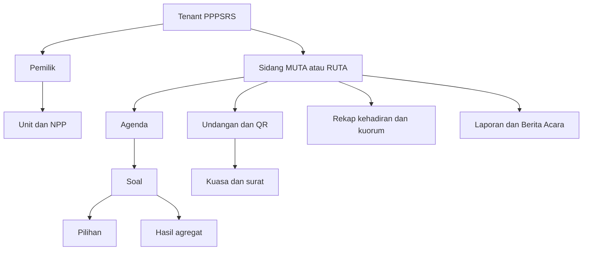
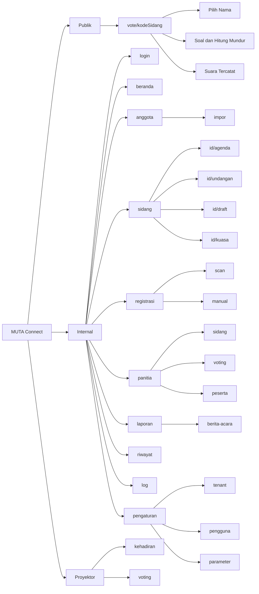

# Information Architecture – MUTA Connect

**Versi 1.0 | Mengacu pada SRS dan User Flow MUTA Connect v1.0 | Bahasa Indonesia**

Catatan: frontend di GitHub Pages memakai **hash routing** (`#/...`) sehingga tidak butuh konfigurasi server. Konteks tenant dan sidang dipilih di bilah atas dan terbawa di seluruh halaman.

## 1. Sitemap

```mermaid
flowchart TD
  R[MUTA Connect] --> L[Login]
  R --> V[Voting Pemilih - publik]
  R --> P[Proyektor - tab terpisah]
  R --> A[Aplikasi Internal]
  V --> V1[Pilih Nama]
  V --> V2[Soal Aktif]
  V --> V3[Suara Tercatat]
  V --> V4[Menunggu Soal]
  V --> V5[Dikeluarkan Panitia]
  P --> P1[Dashboard Kehadiran]
  P --> P2[Dashboard Voting]
  A --> B[Beranda]
  A --> M1[Anggota]
  A --> M2[Sidang]
  A --> M3[Undangan dan Kuasa]
  A --> M4[Registrasi]
  A --> M5[Ruang Panitia]
  A --> M6[Laporan]
  A --> M7[Riwayat]
  A --> M8[Log Aktivitas]
  A --> M9[Pengaturan]
  M1 --> M11[Daftar Anggota]
  M1 --> M12[Impor CSV]
  M2 --> M21[Daftar Sidang]
  M2 --> M22[Agenda dan Soal]
  M3 --> M31[Undangan dan QR]
  M3 --> M32[Draft Email dan WA]
  M3 --> M33[Kuasa]
  M4 --> M41[Scan QR]
  M4 --> M42[Check-in Manual]
  M5 --> M51[Kendali Sidang]
  M5 --> M52[Kendali Voting]
  M5 --> M53[Daftar Peserta]
  M6 --> M61[Laporan Sidang]
  M6 --> M62[Berita Acara]
  M9 --> M91[Tenant]
  M9 --> M92[Pengguna]
  M9 --> M93[Parameter]
```

## 2. Navigation Structure

| Tingkat | Bentuk | Isi |
| --- | --- | --- |
| Global (bilah atas) | Logo, pemilih tenant, pemilih sidang, nama pengguna, keluar | Konteks kerja, tampil di seluruh halaman internal |
| Utama | Menu samping (desktop) atau menu bawah (HP) | Modul sesuai peran |
| Lokal | Tab di dalam modul | Misal Anggota: Daftar, Impor CSV |
| Kontekstual | Tombol aksi di halaman | Tambah, ekspor, cetak, tombol kendali |
| Utilitas | Pencarian cepat peserta | Cari nama atau unit |

Pemilih publik dan layar proyektor **tanpa navigasi** agar bersih.

## 3. Menu Structure

| Menu | Submenu | Admin | Panitia | Petugas |
| --- | --- | --- | --- | --- |
| Beranda | Ringkasan sidang aktif | Ya | Ya | Ya |
| Anggota | Daftar Anggota, Impor CSV | Ya | Lihat | - |
| Sidang | Daftar Sidang, Agenda dan Soal | Ya | Lihat | - |
| Undangan dan Kuasa | Undangan dan QR, Draft Email/WA, Kuasa | Ya | - | - |
| Registrasi | Scan QR, Check-in Manual | Manual | - | Ya |
| Ruang Panitia | Kendali Sidang, Kendali Voting, Daftar Peserta | Ya | Ya | - |
| Laporan | Laporan Sidang, Berita Acara | Ya | Laporan | - |
| Riwayat | Antar Sidang | Ya | Ya | - |
| Log Aktivitas | Log | Ya | Lihat | - |
| Pengaturan | Tenant, Pengguna, Parameter | Ya | - | - |

## 4. Module Structure

| Modul | Cakupan | Kebutuhan SRS |
| --- | --- | --- |
| Autentikasi | Login, ganti password | FR-AUTH |
| Tenant dan Pengguna | Tenant, akun, peran | FR-TEN, FR-AUTH |
| Anggota | Pemilik, unit, impor CSV, riwayat | FR-MEM |
| Sidang | Sidang, agenda, soal, materi | FR-AGD, FR-VOT-01 |
| Undangan | UID, QR, draft | FR-INV |
| Kuasa | Kuasa dan surat | FR-PRX |
| Registrasi | Scan, manual, batal | FR-REG |
| Dashboard | Kehadiran, voting | FR-DSH |
| Voting | Kendali panitia, halaman pemilih | FR-VOT |
| Laporan | Laporan, berita acara, riwayat | FR-RPT, FR-HIS |
| Audit | Log aktivitas | FR-LOG |

## 5. Screen Inventory

| ID | Layar | Pengguna | Perangkat utama |
| --- | --- | --- | --- |
| S-01 | Login | Semua pengguna internal | Semua |
| S-02 | Ganti password | Pengguna | Semua |
| S-03 | Beranda (per peran) | Admin, Panitia, Petugas | Laptop dan HP |
| S-04 | Daftar Anggota | Admin, Panitia | Laptop |
| S-05 | Form Anggota dan Unit | Admin | Laptop |
| S-06 | Impor CSV (unggah, pratinjau, hasil) | Admin | Laptop |
| S-07 | Daftar Sidang | Admin, Panitia | Laptop |
| S-08 | Form Sidang | Admin | Laptop |
| S-09 | Agenda dan Soal | Admin | Laptop |
| S-10 | Undangan dan QR | Admin | Laptop |
| S-11 | Draft Email dan WA | Admin | Laptop |
| S-12 | Kelola Kuasa | Admin | Laptop |
| S-13 | Scan QR | Petugas | Laptop dan HP |
| S-14 | Check-in Manual | Petugas, Admin | Laptop dan HP |
| S-15 | Kendali Sidang | Panitia | Laptop |
| S-16 | Kendali Voting | Panitia | Laptop |
| S-17 | Daftar Peserta (kick, TIDAK HADIR) | Panitia | Laptop |
| S-18 | Dashboard Kehadiran | Layar proyektor | Proyektor |
| S-19 | Dashboard Voting | Layar proyektor | Proyektor |
| S-20 | Voting: Pilih Nama | Pemilih | HP |
| S-21 | Voting: Soal dan Hitung Mundur | Pemilih | HP |
| S-22 | Voting: Suara Tercatat | Pemilih | HP |
| S-23 | Voting: Menunggu Soal | Pemilih | HP |
| S-24 | Voting: Dikeluarkan Panitia | Pemilih | HP |
| S-25 | Laporan Sidang | Admin, Panitia | Laptop |
| S-26 | Berita Acara | Admin | Laptop |
| S-27 | Riwayat Antar Sidang | Admin, Panitia | Laptop |
| S-28 | Log Aktivitas | Admin, Panitia | Laptop |
| S-29 | Pengaturan Tenant | Admin | Laptop |
| S-30 | Pengaturan Pengguna | Admin | Laptop |
| S-31 | Parameter (ambang kuorum, ekstensi file, interval refresh) | Admin | Laptop |

## 6. Page Inventory

| Halaman | Komponen utama | Data yang ditampilkan |
| --- | --- | --- |
| Beranda Admin | Kartu status sidang, pintasan, peringatan QR terpakai | Sidang aktif, jumlah hadir, peringatan |
| Beranda Panitia | Status kuorum, tombol Mulai/Tutup Sidang, pintasan | Kuorum, status sidang |
| Beranda Petugas | Tombol besar Scan QR, Check-in Manual | Jumlah check-in hari ini |
| Daftar Anggota | Tabel, pencarian, filter, tombol impor | Nama, unit, NPP (email dan HP hanya Admin) |
| Scan QR | Pratinjau kamera, kartu hasil, daftar check-in terakhir | Nama, unit, NPP, label On time/Late |
| Dashboard Kehadiran | Jam WIB, titik live, judul, panel angka, kartu pemilik | Hadir/terdaftar, persen NPP hadir dan tidak hadir, persen kuorum, unit hadir/total |
| Dashboard Voting | Soal aktif, hitung mundur, progres, hasil | Sudah memilih/hadir, hasil agregat setelah ditutup |
| Kendali Voting | Daftar soal, tombol Buka/Tutup, status kuorum | Soal per agenda, status soal |
| Daftar Peserta | Tabel, filter status, tombol Kick/Aktifkan, TIDAK HADIR | Nama, unit, status, dikick |
| Voting Pemilih | Pencarian nama, soal, pilihan, tombol Kirim | Soal dan sisa waktu |
| Laporan Sidang | Daftar laporan, tombol ekspor PDF/Excel | RPT-01 sampai RPT-06, RPT-08 |
| Berita Acara | Kerangka terisi otomatis, tombol unduh PDF | Kehadiran dan hasil voting |
| Riwayat | Daftar sidang, perbandingan | Kehadiran dan hasil agregat antar sidang |
| Log Aktivitas | Tabel, filter waktu/pengguna/aksi | Entri log |

## 7. Permission Matrix

Keterangan: **V** = lihat, **E** = ubah/aksi, **X** = ekspor, "-" = tidak ada akses.

| Layar | Admin | Panitia | Petugas | Pemilih |
| --- | --- | --- | --- | --- |
| S-01, S-02 Login dan ganti password | V E | V E | V E | - |
| S-03 Beranda | V | V | V | - |
| S-04 Daftar Anggota | V E | V (tanpa email/HP) | V (cari saja) | - |
| S-05, S-06 Form dan impor | V E | - | - | - |
| S-07 Daftar Sidang | V E | V | - | - |
| S-08, S-09 Form sidang, agenda, soal | V E | V | - | - |
| S-10 sampai S-12 Undangan, draft, kuasa | V E | - | - | - |
| S-13 Scan QR | - | - | V E | - |
| S-14 Check-in manual | V E | - | V E | - |
| S-15, S-16 Kendali sidang dan voting | V E | V E | - | - |
| S-17 Daftar peserta (kick, TIDAK HADIR) | V E | V E | - | - |
| S-18, S-19 Dashboard proyektor | V | V | - | - |
| S-20 sampai S-24 Voting pemilih | - | - | - | V E |
| S-25 Laporan | V X | V X | - | - |
| S-26 Berita acara | V E X | V | - | - |
| S-27 Riwayat | V X | V X | - | - |
| S-28 Log | V | V | - | - |
| S-29 sampai S-31 Pengaturan | V E | - | - | - |

Aturan tambahan: Admin dapat mengubah rekap terkunci dengan alasan (lihat User Flow UF-13). Data pribadi hanya terlihat oleh Admin. Dashboard proyektor tidak memuat email dan nomor HP.

## 8. Taxonomy

| Kelompok | Istilah standar |
| --- | --- |
| Jenis sidang | MUTA, RUTA |
| Status sidang | Draft, Aktif, Berjalan, Ditutup (Terkunci) |
| Status kehadiran | HADIR, TIDAK HADIR, BELUM HADIR |
| Label waktu | On time, Late |
| Status QR | Aktif, Terpakai, Dicabut |
| Status kuasa | Aktif, Dibatalkan |
| Jenis soal | Setuju/Tidak/Abstain, Pilih Satu, Pilih Banyak |
| Status soal | Draft, Dibuka, Ditutup |
| Status voting peserta | Boleh memilih, Sudah memilih, Dikeluarkan (kick) |
| Peran | Admin, Panitia, Petugas Registrasi, Pemilih |
| Istilah bisnis | Pemilik, Penerima Kuasa, Pemberi Kuasa, NPP, Kuorum, Tenant (PPPSRS) |

Seluruh label dalam Bahasa Indonesia dan konsisten di menu, laporan, dan email.

## 9. Content Hierarchy

Hierarki tampilan pada dashboard: **judul sidang dan PPPSRS**, lalu **angka utama** (hadir, persen NPP, kuorum, unit), lalu **kartu pemilik**. Pada Dashboard Voting: **soal**, lalu **hitung mundur**, lalu **progres memilih**, lalu **hasil**.

## 10. Mobile Navigation

| Peran | Pola | Isi |
| --- | --- | --- |
| Petugas (HP) | Menu bawah dengan 3 tab | Scan, Manual, Beranda |
| Admin dan Panitia (HP) | Menu bawah 4 tab dan menu "Lainnya" | Beranda, Peserta, Kendali, Laporan, Lainnya (sisa menu) |
| Pemilih | Tanpa menu, alur satu layar | Pilih Nama, Soal, Konfirmasi |

Prinsip: tombol besar, satu tugas per layar, bilah atas menampilkan tenant dan sidang.

## 11. Desktop Navigation

| Area | Pola |
| --- | --- |
| Bilah atas | Logo, pemilih tenant dan sidang, pencarian peserta, pengguna, keluar |
| Menu samping | Daftar menu sesuai peran, dapat dilipat |
| Konten | Tab lokal, tabel, kartu, tombol aksi |
| Proyektor | Tab terpisah "Buka Proyektor" tanpa menu, layar penuh, tombol kembali tersembunyi |

## 12. URL Structure

Pola: `https://<akun>.github.io/muta-connect/#/<modul>/<halaman>`. Tenant dan sidang dibawa lewat pemilih konteks atau parameter `?t=<tenant_id>&s=<sidang_id>` setelah tanda `#`.

| Layar | URL |
| --- | --- |
| Login | `#/login` |
| Beranda | `#/beranda` |
| Anggota | `#/anggota` , `#/anggota/impor` , `#/anggota/baru` |
| Sidang | `#/sidang` , `#/sidang/baru` , `#/sidang/:id/agenda` |
| Undangan | `#/sidang/:id/undangan` , `#/sidang/:id/draft` , `#/sidang/:id/kuasa` |
| Registrasi | `#/registrasi/scan` , `#/registrasi/manual` |
| Ruang Panitia | `#/panitia/sidang` , `#/panitia/voting` , `#/panitia/peserta` |
| Proyektor | `#/proyektor/kehadiran` , `#/proyektor/voting` |
| Pemilih | `#/vote/:kodeSidang` |
| Laporan | `#/laporan` , `#/laporan/berita-acara` |
| Riwayat | `#/riwayat` |
| Log | `#/log` |
| Pengaturan | `#/pengaturan/tenant` , `#/pengaturan/pengguna` , `#/pengaturan/parameter` |

Aturan: huruf kecil, kata dipisah tanda hubung, tanpa data pribadi atau UID QR di URL. `kodeSidang` pada tautan voting adalah kode publik acak, bukan ID internal.

## 13. Breadcrumb Strategy

| Prinsip | Aturan |
| --- | --- |
| Tampil | Layar internal dengan kedalaman 2 tingkat atau lebih |
| Tidak tampil | Beranda, Scan QR, proyektor, halaman pemilih |
| Pola | Tenant > Sidang > Modul > Halaman |
| Contoh | `PPPSRSKC Ciputra World 1 > MUTA 2026 > Agenda dan Soal > Soal 3` |
| HP | Hanya tombol kembali dan judul halaman |
| Perilaku | Setiap segmen dapat diklik, segmen terakhir bukan tautan |

## 14. Tree Diagram

