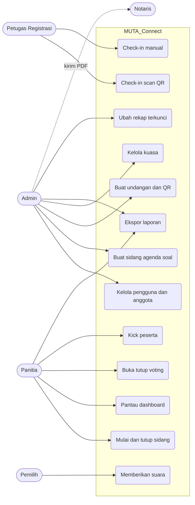
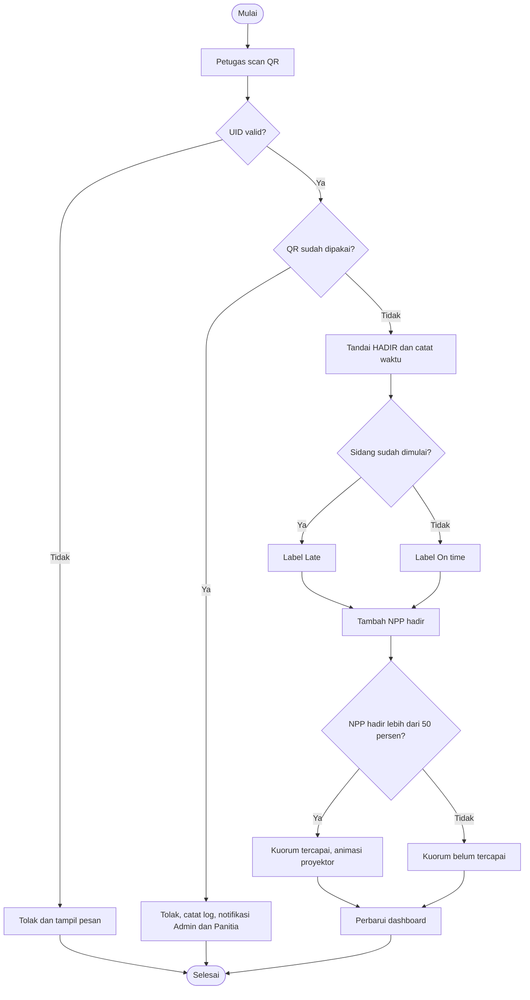
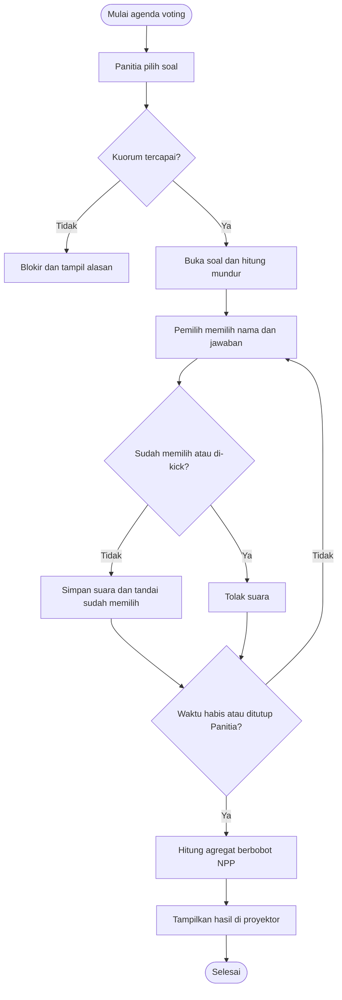
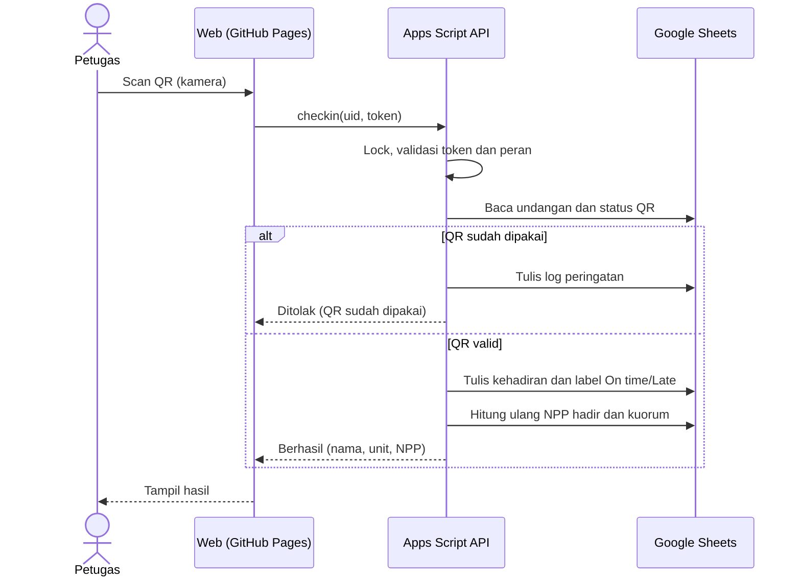
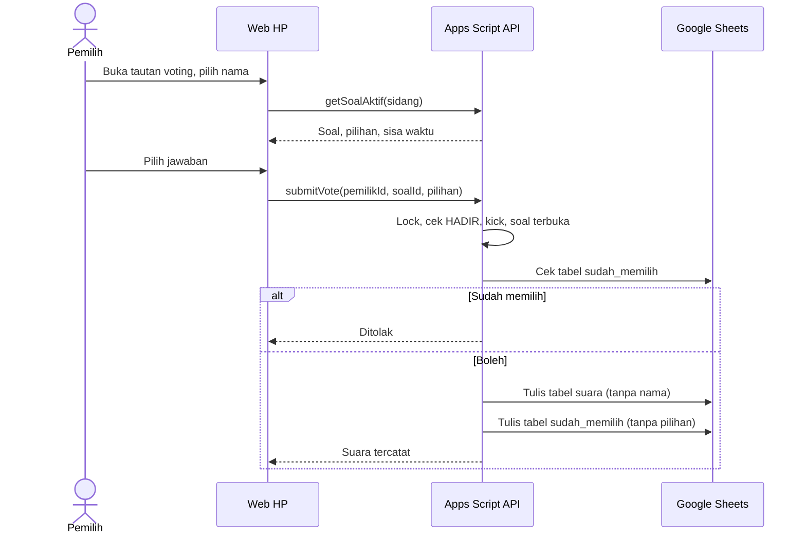
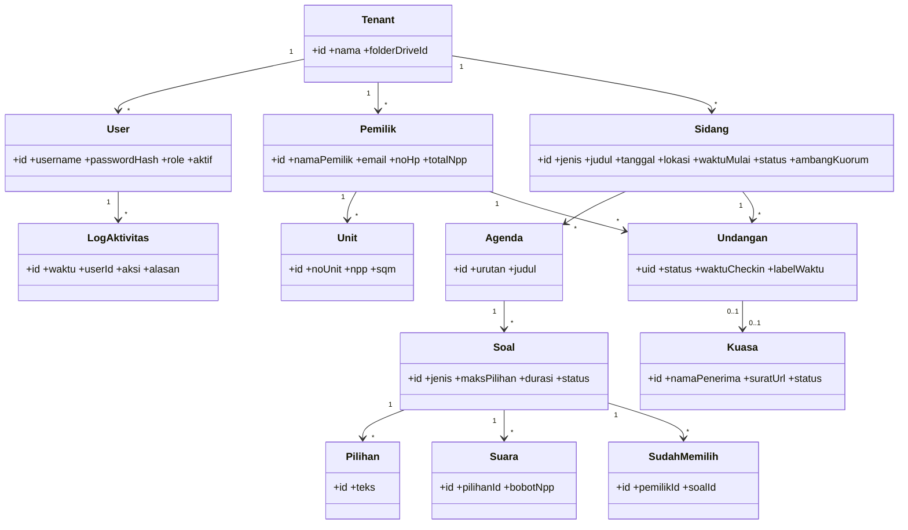
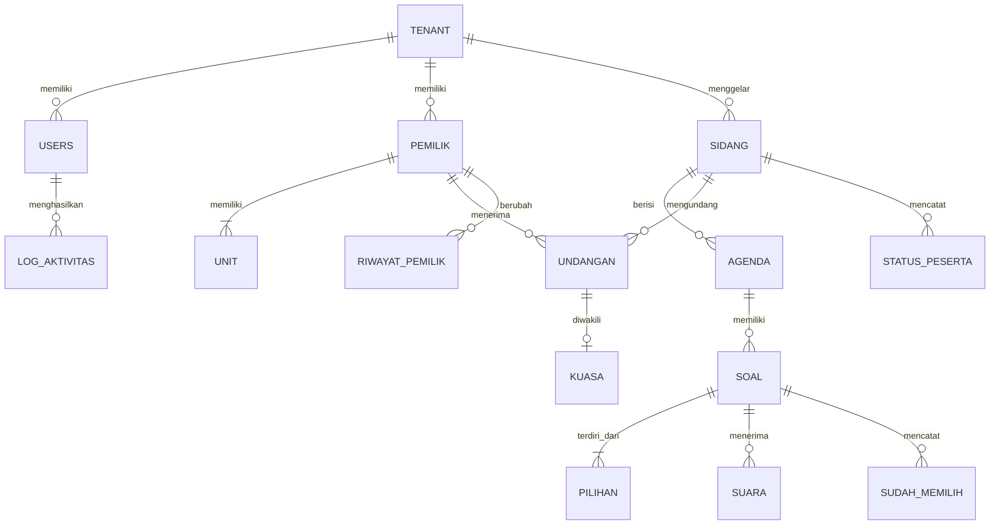
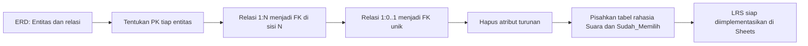
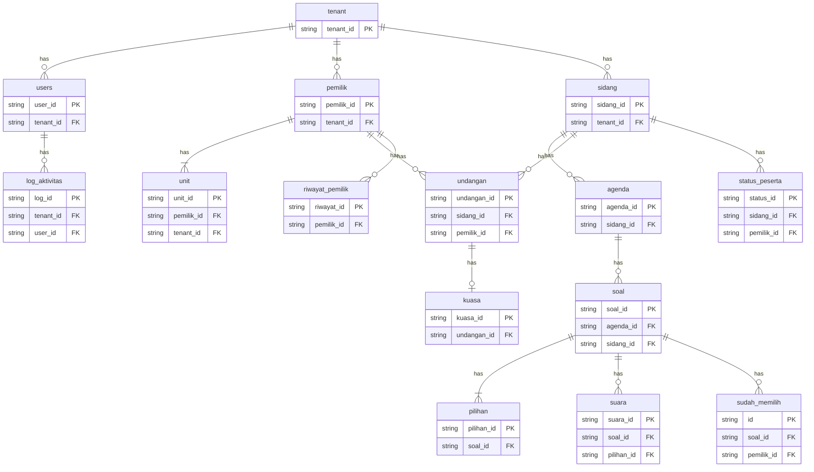

# Software Requirement Specification (SRS) – MUTA Connect

**Versi 1.0 | Mengacu pada IEEE 29148 | Bahasa Indonesia | Status: Baseline disetujui**

## 1. Introduction

### 1.1 Tujuan Dokumen

Dokumen ini menetapkan kebutuhan fungsional dan non-fungsional aplikasi **MUTA Connect**, sebagai acuan bagi pengembang, pengelola (Admin), panitia, dan pihak pengurus PPPSRS dalam membangun, menguji, dan menerima aplikasi.

### 1.2 Deskripsi Produk

MUTA Connect adalah aplikasi web responsif untuk mendukung pelaksanaan Musyawarah Umum Tahunan Anggota (MUTA) dan Rapat Umum Tahunan Anggota Luar Biasa (RUTA) PPPSRS secara onsite. Aplikasi bersifat **multi-tenant** (satu tenant = satu PPPSRS) dan mencakup manajemen anggota/unit, undangan dengan QR Code, check-in kehadiran, dashboard kuorum real-time, agenda, voting elektronik rahasia berbobot NPP bergaya Kahoot, laporan, dan log aktivitas.

### 1.3 Definisi dan Singkatan

| Istilah | Arti |
| --- | --- |
| MUTA | Musyawarah Umum Tahunan Anggota |
| RUTA | Rapat Umum Tahunan Anggota (luar biasa) |
| PPPSRS | Perhimpunan Pemilik dan Penghuni Satuan Rumah Susun |
| NPP | Nilai Perbandingan Proporsional, dasar bobot hak suara |
| Tenant | Satu PPPSRS beserta datanya |
| Pemilik | Anggota yang memiliki satu atau lebih unit |
| Kuasa | Pihak yang diberi wewenang hadir dan memilih atas nama pemilik |
| Kuorum | Ambang NPP hadir agar sidang sah (>50%) |
| UID | Kode acak unik yang menjadi isi QR Code |
| Agregat | Hasil suara yang dijumlahkan tanpa nama pemilih |

### 1.4 Referensi

- IEEE 29148 (Requirements Engineering).
- Hasil wawancara requirement discovery dan Requirement Baseline Summary.
- AD/ART PPPSRS: belum ada acuan resmi saat ini (open item).

## 2. System Objectives

| ID | Tujuan | Indikator Keberhasilan |
| --- | --- | --- |
| OBJ-01 | Menghilangkan antrean registrasi manual | Check-in satu peserta selesai dalam hitungan detik melalui scan QR |
| OBJ-02 | Menghilangkan salah hitung kuorum | Kuorum dihitung otomatis dari NPP hadir setiap check-in |
| OBJ-03 | Voting rahasia, cepat, dan akurat | Rekap suara otomatis setelah voting ditutup, tanpa hitung manual |
| OBJ-04 | Transparansi proses | Dashboard proyektor real-time (refresh 5 detik) |
| OBJ-05 | Dokumentasi akurat | Laporan PDF/Excel dan berita acara otomatis |
| OBJ-06 | Biaya nol | Berjalan pada akun Google pribadi dan GitHub Pages tanpa biaya |

## 3. Scope

### 3.1 In Scope

- Manajemen tenant, pengguna, anggota/unit (input manual dan impor CSV dengan template).
- Pembuatan sidang (MUTA/RUTA), undangan dan QR Code, draft email dan WhatsApp (teks siap salin).
- Check-in kamera (laptop/HP) dan check-in manual, kuasa dengan unggah surat.
- Dashboard kehadiran dan dashboard voting (tab proyektor terpisah).
- Agenda, soal voting (setuju/tidak/abstain, pilih satu, pilih banyak) dengan hitung mundur.
- Rekap, laporan PDF/Excel, berita acara otomatis, riwayat antar sidang, log aktivitas.

### 3.2 Out of Scope

- Notulen otomatis, pembayaran iuran, voting online/jarak jauh.
- Pengiriman email/WhatsApp otomatis (dikirim manual via Outlook/WhatsApp).
- MFA, CAPTCHA, verifikasi email, pendaftaran mandiri, batas sesi.
- Kop surat dan logo pada laporan, mode uji coba terpisah, impor data historis.
- Backup otomatis (salinan Spreadsheet dilakukan manual sebelum dan sesudah sidang).

## 4. Stakeholder Analysis

| Stakeholder | Peran | Kepentingan | Pengaruh |
| --- | --- | --- | --- |
| Pengurus PPPSRS | Sponsor, pengambil keputusan | Sidang sah, efisien, transparan | Tinggi |
| Admin | Pengelola data dan soal | Data akurat, kontrol penuh | Tinggi |
| Panitia | Pelaksana sidang | Kontrol voting dan pemantauan | Tinggi |
| Petugas Registrasi | Scan QR | Check-in cepat tanpa antrean | Sedang |
| Pemilih (anggota) | Peserta | Memilih mudah dari HP, rahasia terjaga | Sedang |
| Penerima Kuasa | Peserta mewakili pemilik | Hak suara pemberi kuasa sah | Sedang |
| Notaris | Penerima laporan | Rekap dan berita acara akurat | Sedang |

## 5. As-Is Process

Seluruh proses dilakukan manual:

1. Panitia mencetak daftar hadir dan anggota menandatangani di meja registrasi (antrean panjang).
2. Rekap kehadiran dan NPP dihitung manual secara berkala.
3. Kuorum dihitung manual, rawan salah hitung.
4. Voting dilakukan angkat tangan atau kertas suara, dihitung manual.
5. Dokumentasi disusun setelah sidang, lambat dan rawan tidak akurat.

**Masalah:** antrean, rekap lambat, salah hitung kuorum, voting manual rawan sengketa, tidak ada dashboard.

## 6. To-Be Process

1. Admin membuat tenant, mengimpor anggota, membuat sidang dan soal.
2. Sistem menghasilkan UID dan QR per undangan, serta draft email/WhatsApp.
3. Admin mengirim undangan manual via Outlook/WhatsApp.
4. Pada hari sidang, Petugas scan QR, kehadiran dan kuorum terhitung otomatis.
5. Panitia menekan **Mulai Sidang**. Check-in setelahnya berlabel **Late**.
6. Panitia membuka soal voting setelah kuorum tercapai. Pemilih memilih dari HP.
7. Panitia menutup voting, hasil agregat tampil di proyektor.
8. Panitia **Tutup Sidang**, rekap dikunci. Admin mengekspor laporan dan berita acara untuk notaris.

## 7. Functional Requirements

Prioritas: **M** = Must, **S** = Should.

### 7.1 Autentikasi dan Pengguna (FR-AUTH)

| ID | Kebutuhan | Prio |
| --- | --- | --- |
| FR-AUTH-01 | Login memakai username dan password buatan sendiri untuk Admin, Panitia, Petugas | M |
| FR-AUTH-02 | Akun Admin awal dibuat saat instalasi, akun lain ditambahkan Admin, tanpa pendaftaran mandiri | M |
| FR-AUTH-03 | Password disimpan dalam bentuk hash, tidak terbaca siapa pun | M |
| FR-AUTH-04 | Reset password oleh Admin dengan password sementara | M |
| FR-AUTH-05 | Pemilih tidak login, mengakses lewat tautan/QR voting umum | M |
| FR-AUTH-06 | Tidak ada batas waktu sesi, tidak ada MFA, CAPTCHA, verifikasi email | M |

### 7.2 Tenant (FR-TEN)

| ID | Kebutuhan | Prio |
| --- | --- | --- |
| FR-TEN-01 | Admin mengelola tenant (nama PPPSRS) | M |
| FR-TEN-02 | Seluruh data (anggota, sidang, suara) terikat kolom tenant pada satu Spreadsheet bersama | M |
| FR-TEN-03 | Pengguna hanya mengakses data tenant yang ditugaskan | M |
| FR-TEN-04 | Setiap tenant memiliki folder Drive untuk dokumen | S |

### 7.3 Data Anggota dan Unit (FR-MEM)

| ID | Kebutuhan | Prio |
| --- | --- | --- |
| FR-MEM-01 | CRUD anggota (pemilik) dan unit secara manual | M |
| FR-MEM-02 | Impor CSV dengan template: no\_unit, nama\_anggota, nama\_tenant, npp, sqm, email, no\_hp | M |
| FR-MEM-03 | Validasi impor: duplikat unit, NPP bukan angka, kolom wajib kosong; tampilkan laporan baris gagal | M |
| FR-MEM-04 | Satu pemilik dapat memiliki banyak unit, tidak ada satu unit banyak pemilik | M |
| FR-MEM-05 | Bobot suara pemilik = total NPP seluruh unitnya | M |
| FR-MEM-06 | Perubahan data anggota disimpan sebagai riwayat | M |
| FR-MEM-07 | Data pribadi (email, HP) hanya terlihat oleh Admin | M |
| FR-MEM-08 | Unduh template CSV | M |

### 7.4 Sidang dan Agenda (FR-AGD)

| ID | Kebutuhan | Prio |
| --- | --- | --- |
| FR-AGD-01 | Admin membuat sidang: jenis (MUTA/RUTA), judul, tanggal, lokasi, tahun | M |
| FR-AGD-02 | Admin menyusun agenda sidang berurutan | M |
| FR-AGD-03 | Panitia menekan **Mulai Sidang**, waktu tercatat sebagai patokan Late | M |
| FR-AGD-04 | Panitia menekan **Tutup Sidang**, rekap terkunci | M |
| FR-AGD-05 | Parameter ambang kuorum per sidang (default >50% NPP) | M |
| FR-AGD-06 | Unggah materi sidang (PDF/JPG/JPEG/PNG) ke Drive | S |

### 7.5 Undangan dan QR (FR-INV)

| ID | Kebutuhan | Prio |
| --- | --- | --- |
| FR-INV-01 | Sistem membuat undangan per pemilik dengan UID acak unik berisi tanpa data pribadi | M |
| FR-INV-02 | QR Code dibuat di browser dari UID, berlaku satu kali pakai | M |
| FR-INV-03 | Draft email lengkap: nama tenant dan nama personal, jenis dan tanggal sidang, lokasi, agenda, QR di badan email, tata tertib, tanda tangan pengurus | M |
| FR-INV-04 | Tombol **Salin ke clipboard** agar gambar QR ikut tertanam saat ditempel ke Outlook | M |
| FR-INV-05 | Draft tambahan: pengingat H-1, ucapan terima kasih, kirim ulang QR, hasil sidang | M |
| FR-INV-06 | Teks siap salin untuk WhatsApp | M |
| FR-INV-07 | Admin dapat menerbitkan QR baru, QR lama otomatis tidak berlaku | M |

### 7.6 Check-in (FR-REG)

| ID | Kebutuhan | Prio |
| --- | --- | --- |
| FR-REG-01 | Petugas scan QR memakai kamera laptop/HP | M |
| FR-REG-02 | Check-in sukses menandai status HADIR, mencatat waktu, dan label On time/Late | M |
| FR-REG-03 | QR yang sudah dipakai ditolak, tampil peringatan ke Petugas, masuk log, notifikasi ke Admin dan Panitia | M |
| FR-REG-04 | Check-in manual oleh Petugas melalui pencarian nama/unit, wajib alasan dan log | M |
| FR-REG-05 | Status kehadiran: HADIR, TIDAK HADIR (dicatat manual oleh Admin/Panitia), BELUM HADIR | M |
| FR-REG-06 | Admin membatalkan check-in yang salah dengan alasan dan log | M |
| FR-REG-07 | Petugas hanya memiliki fungsi scan dan check-in manual, tanpa ekspor | M |
| FR-REG-08 | Setiap check-in menambah NPP hadir dan memperbarui kuorum otomatis | M |

### 7.7 Kuasa (FR-PRX)

| ID | Kebutuhan | Prio |
| --- | --- | --- |
| FR-PRX-01 | Satu undangan = satu kuasa | M |
| FR-PRX-02 | Kuasa wajib mengunggah surat kuasa (PDF/JPG/JPEG/PNG) ke Drive, cukup diunggah tanpa verifikasi | M |
| FR-PRX-03 | Penerima kuasa membawa hak suara pemberi kuasa saja (total NPP seluruh unit pemberi), tanpa suara pribadi | M |
| FR-PRX-04 | Kuasa dihitung sebagai hadir dalam kuorum | M |
| FR-PRX-05 | Kartu dashboard menampilkan nama penerima kuasa dan pemberi kuasa | M |
| FR-PRX-06 | Pemberi kuasa yang ingin hadir sendiri: Admin membatalkan kuasa (log), lalu check-in sendiri | M |

### 7.8 Dashboard (FR-DSH)

| ID | Kebutuhan | Prio |
| --- | --- | --- |
| FR-DSH-01 | Dashboard Kehadiran (tab proyektor bersih): jam dan tanggal WIB, indikator live (titik hijau berkedip), judul sidang dan nama PPPSRS | M |
| FR-DSH-02 | Menampilkan peserta hadir/terdaftar, persen NPP hadir, persen NPP tidak hadir, persen kuorum, unit hadir/total unit | M |
| FR-DSH-03 | Card per pemilik: unit, status (HADIR/TIDAK HADIR/BELUM HADIR), label On time/Late, nama tenant, nama pemilik/kuasa, NPP, jumlah unit | M |
| FR-DSH-04 | Animasi khusus saat kuorum tercapai | M |
| FR-DSH-05 | Refresh otomatis setiap 5 detik | M |
| FR-DSH-06 | Dashboard Voting terpisah: soal aktif, hitung mundur, jumlah sudah memilih dari jumlah hadir | M |
| FR-DSH-07 | Tampilan Panitia dengan tombol kontrol terpisah dari layar proyektor | M |
| FR-DSH-08 | Pencarian dan filter card (status, nama, unit) | S |

### 7.9 Voting (FR-VOT)

| ID | Kebutuhan | Prio |
| --- | --- | --- |
| FR-VOT-01 | Admin membuat soal per agenda: jenis (setuju/tidak/abstain, pilih satu, pilih banyak), pilihan, durasi hitung mundur | M |
| FR-VOT-02 | Pilih banyak: Admin mengatur maksimal pilihan, tiap pilihan menerima bobot NPP pemilih penuh | M |
| FR-VOT-03 | Panitia membuka dan menutup soal, soal tidak bisa dibuka jika kuorum belum tercapai | M |
| FR-VOT-04 | Pemilih membuka tautan/QR voting umum di HP dan memilih nama dari daftar peserta yang sudah check-in | M |
| FR-VOT-05 | Satu pemilik satu suara per soal, suara ganda ditolak | M |
| FR-VOT-06 | Voting rahasia: data "sudah memilih" dan "pilihan" disimpan terpisah tanpa penghubung per nama | M |
| FR-VOT-07 | Hitung mundur ala Kahoot, soal tertutup otomatis saat waktu habis | M |
| FR-VOT-08 | Peserta yang check-in terlambat boleh memilih soal yang sedang berjalan | M |
| FR-VOT-09 | Panitia dapat mengeluarkan (kick) peserta dengan nama tidak sesuai, suara yang sudah masuk tetap dihitung, tercatat di log | M |
| FR-VOT-10 | Panitia dapat mengaktifkan kembali peserta yang di-kick, tercatat di log | M |
| FR-VOT-11 | Hasil agregat tampil hanya setelah soal ditutup | M |
| FR-VOT-12 | Pemilih yang terputus dapat mengirim ulang, sistem menolak suara ganda | M |
| FR-VOT-13 | Notifikasi HP pemilih: voting dimulai/ditutup, suara tercatat, dikeluarkan panitia | M |

### 7.10 Laporan (FR-RPT)

| ID | Kebutuhan | Prio |
| --- | --- | --- |
| FR-RPT-01 | Laporan: daftar hadir, rekap kuorum, hasil voting per agenda (agregat), daftar kuasa, log aktivitas, riwayat antar sidang | M |
| FR-RPT-02 | Ekspor PDF dan Excel, tanpa kop surat | M |
| FR-RPT-03 | Berita acara berupa kerangka otomatis, hasil voting terisi otomatis, dilengkapi dan ditandatangani manual | M |
| FR-RPT-04 | Panitia boleh melihat dan mengekspor laporan, data pribadi hanya Admin | M |
| FR-RPT-05 | Cetak/ekspor daftar anggota PDF untuk daftar hadir kertas cadangan | M |
| FR-RPT-06 | Notaris menerima file PDF dari Admin, tanpa login | M |

### 7.11 Riwayat dan Log (FR-HIS, FR-LOG)

| ID | Kebutuhan | Prio |
| --- | --- | --- |
| FR-HIS-01 | Halaman riwayat per tenant: kehadiran dan hasil voting antar sidang | M |
| FR-LOG-01 | Seluruh aksi sensitif dicatat: login, ubah data, check-in, kick, buka/tutup soal, kuasa, ubah rekap | M |
| FR-LOG-02 | Perubahan rekap terkunci oleh Admin wajib disertai alasan | M |
| FR-LOG-03 | Log tidak dapat diubah dari antarmuka aplikasi | M |

## 8. Non Functional Requirements

| ID | Kategori | Kebutuhan |
| --- | --- | --- |
| NFR-01 | Performa | Mendukung sekitar 100 pemilih memilih bersamaan, respons simpan suara umumnya < 5 detik |
| NFR-02 | Performa | Dashboard memperbarui data setiap 5 detik dengan cache untuk mengurangi pembacaan Sheets |
| NFR-03 | Konkurensi | Penulisan suara memakai penguncian (LockService) agar tidak ada suara ganda atau hilang |
| NFR-04 | Skalabilitas | Total 810 unit, maksimum 133 unit per tenant, 100-500 anggota per sidang |
| NFR-05 | Kompatibilitas | Chrome terbaru dan browser HP modern, responsif HP/laptop/proyektor |
| NFR-06 | Jaringan | Berfungsi pada Wi-Fi dan data seluler |
| NFR-07 | Biaya | Gratis: GitHub Pages (frontend), Apps Script (backend API), Sheets dan Drive akun Google pribadi |
| NFR-08 | Keamanan | Password di-hash, tautan API memvalidasi token pengguna per peran |
| NFR-09 | Ketersediaan | Mengandalkan layanan gratis tanpa SLA, rencana cadangan manual disiapkan |
| NFR-10 | Usability | Bahasa Indonesia, kontras tinggi untuk proyektor, tombol besar untuk HP |
| NFR-11 | Kapasitas | Dilakukan dalam kuota harian Apps Script akun pribadi |
| NFR-12 | Akurasi | NPP disimpan penuh, persentase ditampilkan 4 desimal |

## 9. Business Rules

| ID | Aturan |
| --- | --- |
| BR-01 | Bobot suara pemilik = total NPP seluruh unit miliknya |
| BR-02 | Kuorum tercapai jika NPP hadir > 50% dari total NPP tenant, dihitung otomatis setiap check-in; kuorum kedua tidak diatur |
| BR-03 | Kuasa dihitung hadir, membawa hak suara pemberi kuasa saja |
| BR-04 | 1 undangan = 1 kuasa, surat kuasa wajib diunggah |
| BR-05 | QR berlaku satu kali pakai, UID acak tanpa data pribadi |
| BR-06 | Voting hanya oleh peserta berstatus HADIR dan tidak di-kick |
| BR-07 | Satu suara per pemilik per soal |
| BR-08 | Soal tidak dapat dibuka sebelum kuorum tercapai |
| BR-09 | Hasil voting tampil setelah soal ditutup, hanya agregat |
| BR-10 | Check-in sebelum Mulai Sidang berlabel On time, sesudahnya Late |
| BR-11 | Setelah Tutup Sidang rekap terkunci, hanya Admin dapat mengubah dengan alasan dan log |
| BR-12 | Pemberi kuasa yang hadir sendiri mensyaratkan pembatalan kuasa oleh Admin |
| BR-13 | Data pribadi hanya terlihat oleh Admin |
| BR-14 | Data dihapus manual oleh Admin, tidak ada kebijakan retensi otomatis |

## 10. User Roles Matrix

Keterangan: **C** = Create, **R** = Read, **U** = Update, **D** = Delete, **X** = Eksekusi aksi, tanda "-" = tidak ada akses.

| Fungsi | Admin | Panitia | Petugas Registrasi | Pemilih (tanpa login) | Notaris |
| --- | --- | --- | --- | --- | --- |
| Kelola tenant dan pengguna | CRUD | - | - | - | - |
| Reset password pengguna | X | - | - | - | - |
| Data anggota/unit (nama, unit, NPP) | CRUD | R | R (pencarian) | - | - |
| Data pribadi (email, HP) | R | - | - | - | - |
| Impor CSV anggota | X | - | - | - | - |
| Buat sidang dan agenda | CRUD | R | - | - | - |
| Buat soal dan pilihan voting | CRUD | R | - | - | - |
| Buat undangan, QR, draft email/WA | CRUD | - | - | - | - |
| Terbitkan QR baru | X | - | - | - | - |
| Scan QR check-in | - | - | X | - | - |
| Check-in manual (alasan wajib) | X | - | X | - | - |
| Batalkan check-in | X | - | - | - | - |
| Catat status TIDAK HADIR | X | X | - | - | - |
| Unggah surat kuasa | CRUD | - | - | - | - |
| Batalkan kuasa | X | - | - | - | - |
| Mulai / Tutup Sidang | X | X | - | - | - |
| Buka / Tutup soal voting | - | X | - | - | - |
| Kick / aktifkan kembali peserta | - | X | - | - | - |
| Dashboard Kehadiran dan Voting | R | R | - | - | - |
| Memberikan suara | - | - | - | X | - |
| Laporan dan ekspor PDF/Excel | R, ekspor | R, ekspor | - | - | - |
| Berita acara otomatis | X | R | - | - | - |
| Log aktivitas | R | R | - | - | - |
| Ubah rekap terkunci (alasan wajib) | X | - | - | - | - |
| Terima file laporan PDF | - | - | - | - | Menerima dari Admin |

## 11. Use Case Specification

| ID | Use Case | Aktor |
| --- | --- | --- |
| UC-01 | Login dan kelola pengguna | Admin |
| UC-02 | Kelola anggota dan impor CSV | Admin |
| UC-03 | Buat sidang, agenda, dan soal | Admin |
| UC-04 | Buat undangan dan QR, salin draft email | Admin |
| UC-05 | Check-in dengan scan QR | Petugas |
| UC-06 | Check-in manual | Petugas |
| UC-07 | Kelola kuasa | Admin |
| UC-08 | Mulai dan Tutup Sidang | Panitia |
| UC-09 | Pantau dashboard kehadiran dan kuorum | Panitia |
| UC-10 | Buka dan tutup soal voting | Panitia |
| UC-11 | Memberikan suara | Pemilih |
| UC-12 | Kick dan aktifkan kembali peserta | Panitia |
| UC-13 | Ekspor laporan dan berita acara | Admin, Panitia |
| UC-14 | Ubah rekap terkunci | Admin |

### UC-05 Check-in dengan Scan QR

| Atribut | Isi |
| --- | --- |
| Aktor | Petugas Registrasi |
| Pra-kondisi | Petugas login, sidang berstatus aktif, kamera diizinkan |
| Pemicu | Peserta menunjukkan QR undangan |
| Alur utama | 1) Petugas membuka layar scan. 2) Kamera membaca UID. 3) Sistem memvalidasi UID, tenant, dan status QR. 4) Sistem menandai HADIR, mencatat waktu, dan label On time/Late. 5) Sistem menambah NPP hadir dan menghitung ulang kuorum. 6) Layar menampilkan "Check-in berhasil" beserta nama, unit, dan NPP. |
| Alur alternatif | A1) Kamera gagal: Petugas memakai check-in manual (UC-06). A2) Pemilik diwakili kuasa: kartu menampilkan nama penerima dan pemberi kuasa. |
| Alur pengecualian | E1) QR sudah dipakai: ditolak, peringatan tampil, log dan notifikasi ke Admin/Panitia. E2) QR tidak dikenal atau dicabut: ditolak. E3) Sidang belum aktif: ditolak. |
| Pasca-kondisi | Status HADIR tersimpan, log tercatat, dashboard terbarui dalam 5 detik |

### UC-10 Buka dan Tutup Soal Voting

| Atribut | Isi |
| --- | --- |
| Aktor | Panitia |
| Pra-kondisi | Sidang sudah dimulai, soal sudah dibuat Admin |
| Pemicu | Agenda masuk tahap pemungutan suara |
| Alur utama | 1) Panitia memilih soal. 2) Sistem memeriksa kuorum. 3) Sistem membuka soal dan memulai hitung mundur. 4) HP pemilih menerima "Voting dimulai". 5) Soal ditutup oleh Panitia atau hitung mundur habis. 6) Sistem menghitung agregat berbobot NPP dan menampilkan hasil. |
| Alur alternatif | A1) Panitia menutup lebih awal. |
| Alur pengecualian | E1) Kuorum belum tercapai: soal diblokir dengan pesan alasan. E2) Ada soal lain yang masih terbuka: ditolak. |
| Pasca-kondisi | Hasil agregat tersimpan, log tercatat |

### UC-11 Memberikan Suara

| Atribut | Isi |
| --- | --- |
| Aktor | Pemilih |
| Pra-kondisi | Pemilih berstatus HADIR, tidak di-kick, soal terbuka |
| Pemicu | Pemilih membuka tautan/QR voting umum di HP |
| Alur utama | 1) Pemilih memilih namanya dari daftar peserta yang sudah check-in (atau mengetik nama untuk pencarian). 2) Sistem menampilkan soal aktif dan hitung mundur. 3) Pemilih memilih jawaban (sesuai jenis soal). 4) Sistem mencatat suara berbobot NPP pemilik atau pemberi kuasa. 5) Sistem menandai pemilik "sudah memilih" di tabel terpisah. 6) HP menampilkan "Suara Anda tercatat". |
| Alur alternatif | A1) Koneksi putus: pemilih mengirim ulang, sistem menolak suara ganda. A2) Terlambat check-in: tetap boleh memilih soal yang berjalan. |
| Alur pengecualian | E1) Nama tidak ditemukan atau belum check-in: ditolak. E2) Sudah memilih: ditolak. E3) Dikeluarkan Panitia: pesan "Anda dikeluarkan panitia". E4) Waktu habis: pemilihan ditutup. |
| Pasca-kondisi | Satu suara tercatat, rahasia terjaga |

### UC-12 Kick dan Aktifkan Kembali Peserta

| Atribut | Isi |
| --- | --- |
| Aktor | Panitia |
| Pemicu | Nama yang dipakai di HP tidak sesuai |
| Alur utama | 1) Panitia memilih peserta. 2) Menekan Kick. 3) Sistem memblokir suara berikutnya, suara lama tetap dihitung. 4) Log tercatat. 5) HP peserta menampilkan pemberitahuan. |
| Alur alternatif | Panitia mengaktifkan kembali peserta, log tercatat |

### UC-07 Kelola Kuasa

| Atribut | Isi |
| --- | --- |
| Aktor | Admin |
| Alur utama | 1) Admin memilih pemberi kuasa. 2) Mengisi nama penerima kuasa. 3) Mengunggah surat kuasa (PDF/JPG/JPEG/PNG). 4) Sistem membuat undangan kuasa dan QR baru. 5) Hak suara = NPP pemberi kuasa. |
| Alur pengecualian | E1) Pemberi kuasa sudah memiliki kuasa lain: ditolak (1 undangan = 1 kuasa). E2) Format file tidak sesuai: ditolak. |
| Alur pembatalan | Pemberi kuasa ingin hadir sendiri: Admin membatalkan kuasa dengan alasan, QR kuasa nonaktif, pemilik check-in sendiri |

## 12. UML Documentation

### 12.1 Use Case Diagram

### 12.2 Activity Diagram – Check-in dan Kuorum

### 12.3 Activity Diagram – Siklus Voting

### 12.4 Sequence Diagram – Check-in

### 12.5 Sequence Diagram – Voting

### 12.6 Class Diagram

## 13. Data Model

Data disimpan dalam **satu Google Spreadsheet bersama**. Setiap sheet (tab) adalah satu tabel, dan seluruh tabel data bisnis memiliki kolom `tenant_id` untuk pemisahan antar PPPSRS. Dokumen (surat kuasa, materi, laporan) disimpan di Google Drive dan Spreadsheet hanya menyimpan tautan/ID file.

| Kelompok | Tabel |
| --- | --- |
| Master data | tenant, users, pemilik, unit, template\_draft |
| Transaksi sidang | sidang, agenda, soal, pilihan, undangan, kuasa, status\_peserta |
| Voting rahasia | suara, sudah\_memilih |
| Audit | log\_aktivitas |
| Riwayat | riwayat\_pemilik |
| Pengaturan | konfigurasi |

**Prinsip kerahasiaan suara:** tabel `suara` hanya menyimpan pilihan dan bobot tanpa `pemilik_id` dan tanpa timestamp. Tabel `sudah_memilih` hanya menyimpan `pemilik_id` dan `soal_id` tanpa pilihan. Tidak ada kolom yang menghubungkan keduanya. Urutan baris `suara` diacak saat soal ditutup untuk mencegah pencocokan berdasarkan urutan masuk.

## 14. ERD

## 15. Transformation ERD to LRS

Aturan transformasi yang diterapkan:

| Relasi ERD | Hasil pada LRS |
| --- | --- |
| 1 : N (Tenant ke Users, Pemilik ke Unit, dst.) | Primary key sisi 1 menjadi foreign key pada sisi N |
| 1 : 0..1 (Undangan ke Kuasa) | `undangan_id` pada Kuasa menjadi FK sekaligus unik |
| Atribut turunan (total NPP, persen kuorum) | Tidak disimpan, dihitung dari Unit dan Undangan, atau di-cache |
| Entitas rahasia (Suara) | Tanpa FK ke Pemilik dan tanpa timestamp |

## 16. LRS (Logical Record Structure)

## 17. Database Schema

Setiap tab Google Sheets memakai baris pertama sebagai header. ID memakai UUID. Seluruh sheet kecuali `tenant` memiliki `tenant_id`.

| Sheet | Kolom |
| --- | --- |
| tenant | tenant\_id, nama\_pppsrs, folder\_drive\_id, total\_npp, dibuat\_pada |
| users | user\_id, tenant\_id, username, password\_hash, salt, role (admin/panitia/petugas), aktif, ganti\_password, dibuat\_pada |
| pemilik | pemilik\_id, tenant\_id, nama\_pemilik, nama\_perusahaan, email, no\_hp, aktif, diubah\_pada |
| unit | unit\_id, tenant\_id, pemilik\_id, no\_unit, npp, sqm |
| template\_draft | template\_id, tenant\_id, jenis (undangan/pengingat/terima\_kasih/kirim\_ulang/hasil/wa), isi |
| sidang | sidang\_id, tenant\_id, jenis (MUTA/RUTA), judul, tanggal, lokasi, tahun, ambang\_kuorum, waktu\_mulai, waktu\_tutup, status (draft/aktif/berjalan/ditutup), terkunci |
| agenda | agenda\_id, tenant\_id, sidang\_id, urutan, judul, deskripsi |
| soal | soal\_id, tenant\_id, sidang\_id, agenda\_id, teks, jenis (setuju\_tidak\_abstain/pilih\_satu/pilih\_banyak), maks\_pilihan, durasi\_detik, status (draft/dibuka/ditutup), waktu\_buka, waktu\_tutup |
| pilihan | pilihan\_id, tenant\_id, soal\_id, teks, urutan |
| undangan | undangan\_id, tenant\_id, sidang\_id, pemilik\_id, uid, status\_qr (aktif/terpakai/dicabut), status\_kehadiran (belum\_hadir/hadir/tidak\_hadir), waktu\_checkin, label\_waktu (on\_time/late), metode (scan/manual), petugas\_id, alasan\_manual |
| kuasa | kuasa\_id, tenant\_id, undangan\_id, nama\_penerima, surat\_file\_id, surat\_url, status (aktif/dibatalkan), dibatalkan\_alasan |
| status\_peserta | status\_id, tenant\_id, sidang\_id, pemilik\_id, dikick (true/false), diubah\_oleh, diubah\_pada |
| suara | suara\_id, tenant\_id, soal\_id, pilihan\_id, bobot\_npp |
| sudah\_memilih | id, tenant\_id, soal\_id, pemilik\_id |
| log\_aktivitas | log\_id, tenant\_id, waktu, user\_id, peran, aksi, objek, detail, alasan |
| riwayat\_pemilik | riwayat\_id, tenant\_id, pemilik\_id, field, nilai\_lama, nilai\_baru, diubah\_oleh, diubah\_pada |
| konfigurasi | kunci, nilai (misal interval refresh 5 detik, ekstensi file yang diizinkan) |

**Catatan implementasi:**

- Kolom `uid` berisi 16 karakter acak kriptografis, tanpa data pribadi.
- Kolom `password_hash` memakai hash dengan salt, hash tidak pernah dikirim ke klien.
- Suara ditulis di bawah `LockService`. Dashboard membaca dari cache dan hanya diperbarui saat ada perubahan.

## 18. Data Dictionary

| Field | Tipe | Aturan | Keterangan |
| --- | --- | --- | --- |
| npp | desimal | > 0, disimpan penuh | NPP satu unit, persen ditampilkan 4 desimal |
| total\_npp (pemilik) | desimal | Jumlah NPP seluruh unit pemilik | Bobot suara pemilik |
| uid | teks | 16 karakter acak, unik | Isi QR Code, tidak berisi data pribadi |
| status\_qr | enum | aktif, terpakai, dicabut | QR satu kali pakai |
| status\_kehadiran | enum | belum\_hadir, hadir, tidak\_hadir | Tiga status kehadiran |
| label\_waktu | enum | on\_time, late | Late jika check-in setelah waktu\_mulai sidang |
| jenis soal | enum | setuju\_tidak\_abstain, pilih\_satu, pilih\_banyak | Jenis voting |
| maks\_pilihan | angka | 1 sampai jumlah pilihan | Hanya untuk pilih\_banyak |
| durasi\_detik | angka | >= 10 | Hitung mundur soal |
| bobot\_npp | desimal | Total NPP pemilik atau pemberi kuasa | Tiap pilihan yang dipilih menerima bobot penuh |
| ambang\_kuorum | desimal | Default 50 (persen), kuorum jika NPP hadir lebih dari ambang | Dapat diatur per sidang |
| role | enum | admin, panitia, petugas | Peran pengguna |
| surat\_file\_id | teks | PDF/JPG/JPEG/PNG | ID file surat kuasa di Drive |
| dikick | boolean | true/false | Peserta diblokir dari voting |
| terkunci | boolean | true setelah Tutup Sidang | Rekap hanya dapat diubah Admin dengan alasan |

## 19. Notification Matrix

| Kejadian | Penerima | Kanal | Isi | Waktu |
| --- | --- | --- | --- | --- |
| Undangan sidang | Anggota | Email (draft, dikirim manual via Outlook) | Nama tenant dan nama personal, jenis dan tanggal sidang, lokasi, agenda, QR di badan email, tata tertib, tanda tangan pengurus | Sebelum sidang |
| Pengingat H-1 | Anggota | Email draft | Pengingat dan QR | H-1 |
| Kirim ulang QR | Anggota | Email draft | QR baru | Sesuai kebutuhan |
| Ucapan terima kasih | Anggota | Email draft | Terima kasih dan kehadiran | Setelah sidang |
| Hasil sidang | Anggota | Email draft | Ringkasan hasil | Setelah sidang |
| Undangan via WhatsApp | Anggota | Teks siap salin (manual) | Ringkasan undangan dan tautan | Sebelum sidang |
| Check-in berhasil | Petugas | Layar scan | Nama, unit, NPP | Seketika |
| QR sudah dipakai | Petugas, Admin, Panitia | Layar scan dan panel peringatan | Peringatan QR terpakai | Seketika |
| Kuorum tercapai | Panitia dan peserta | Dashboard proyektor | Animasi khusus | Seketika |
| Voting dimulai/ditutup | Pemilih | HP | Pemberitahuan | Seketika |
| Suara tercatat | Pemilih | HP | Konfirmasi | Seketika |
| Dikeluarkan panitia | Pemilih | HP | Pemberitahuan | Seketika |

Tidak ada SMS, push notification, maupun integrasi WhatsApp API.

## 20. Security Requirements

| ID | Kebutuhan |
| --- | --- |
| SEC-01 | Password pengguna di-hash dengan salt, tidak pernah dikirim atau ditampilkan, reset hanya oleh Admin dengan password sementara |
| SEC-02 | Setiap permintaan API membawa token sesi, server memvalidasi token, peran, dan `tenant_id` sebelum memproses |
| SEC-03 | Pemisahan tenant: query selalu difilter `tenant_id` dari token, bukan dari input klien |
| SEC-04 | Otorisasi berbasis peran sesuai User Roles Matrix, dicek di sisi server (Apps Script), bukan hanya di antarmuka |
| SEC-05 | Data pribadi (email, HP) hanya dikirim ke klien untuk peran Admin |
| SEC-06 | QR berisi UID acak tanpa data pribadi, satu kali pakai, dapat dicabut oleh Admin |
| SEC-07 | Voting rahasia: tabel `suara` dan `sudah_memilih` tidak terhubung, tanpa timestamp pada `suara`, urutan baris diacak saat soal ditutup |
| SEC-08 | Validasi nama pemilih terhadap peserta HADIR, satu suara per pemilik per soal, penguncian tulis untuk mencegah suara ganda |
| SEC-09 | Panitia dapat meng-kick peserta mencurigakan, tercatat di log |
| SEC-10 | Unggahan surat kuasa dibatasi PDF/JPG/JPEG/PNG, nama file dinormalkan |
| SEC-11 | Rekap terkunci setelah Tutup Sidang, perubahan hanya Admin dengan alasan dan log |
| SEC-12 | Komunikasi memakai HTTPS (GitHub Pages dan Apps Script) |
| SEC-13 | Akses ke Spreadsheet dan folder Drive dibatasi pada akun pemilik, tidak dibagikan ke publik |

**Risiko yang diterima sesuai keputusan Sponsor:** tanpa batas sesi, tanpa MFA, tanpa CAPTCHA. Mitigasi: validasi check-in pada voting, log lengkap, dan akses Admin hanya dari perangkat tepercaya.

## 21. Audit Log Requirements

Setiap entri log memuat: waktu (WIB), pengguna, peran, tenant, aksi, objek, detail, dan alasan (jika wajib). Log bersifat tambah-saja (append-only) dari sisi aplikasi.

| Kategori | Aksi yang dicatat | Alasan wajib |
| --- | --- | --- |
| Akun | Login berhasil/gagal, tambah pengguna, ubah peran, reset password | Tidak |
| Data anggota | Tambah, ubah, hapus, impor CSV | Tidak |
| Undangan | Buat undangan, terbitkan QR baru, cabut QR | Cabut QR: ya |
| Check-in | Scan berhasil, QR terpakai (peringatan), check-in manual, batalkan check-in | Manual dan batalkan: ya |
| Kuasa | Tambah kuasa, unggah surat, batalkan kuasa | Batalkan: ya |
| Sidang | Mulai Sidang, Tutup Sidang | Tidak |
| Voting | Buka soal, tutup soal, kick, aktifkan kembali, upaya suara ditolak | Tidak |
| Rekap | Ubah rekap terkunci | Ya |
| Laporan | Ekspor PDF/Excel, buat berita acara | Tidak |

Log tidak mencatat pilihan pemilih per nama.

## 22. Reporting Requirements

| ID | Laporan | Isi | Format | Akses |
| --- | --- | --- | --- | --- |
| RPT-01 | Daftar Hadir | Nama, unit, status, waktu, label On time/Late, kuasa | PDF, Excel | Admin, Panitia |
| RPT-02 | Rekap Kuorum | NPP hadir/tidak hadir, persen, unit hadir, status kuorum | PDF, Excel | Admin, Panitia |
| RPT-03 | Hasil Voting per Agenda | Soal, jumlah peserta memilih, hasil agregat berbobot NPP | PDF, Excel | Admin, Panitia |
| RPT-04 | Daftar Kuasa | Pemberi, penerima, tautan surat | PDF, Excel | Admin, Panitia |
| RPT-05 | Log Aktivitas | Entri log sesuai filter | PDF, Excel | Admin, Panitia |
| RPT-06 | Riwayat Antar Sidang | Kehadiran dan hasil voting per sidang dalam satu tenant | PDF, Excel | Admin, Panitia |
| RPT-07 | Berita Acara | Kerangka otomatis, hasil voting dan kehadiran terisi, dilengkapi dan ditandatangani manual | PDF | Admin |
| RPT-08 | Daftar Anggota (cadangan kertas) | Nama, unit, NPP, kolom tanda tangan | PDF | Admin |

Catatan: laporan tanpa kop surat atau logo. Laporan untuk notaris dikirim sebagai PDF oleh Admin. Data pribadi tidak dimuat dalam laporan Panitia.

### Dashboard

| Dashboard | Isi |
| --- | --- |
| Kehadiran (proyektor) | Jam dan tanggal WIB, titik hijau berkedip "live", judul sidang, nama PPPSRS, peserta hadir/terdaftar, persen NPP hadir, persen NPP tidak hadir, persen kuorum, unit hadir/total unit, animasi kuorum tercapai, card per pemilik |
| Card pemilik | Unit, status (HADIR/TIDAK HADIR/BELUM HADIR), label On time/Late, nama tenant, nama pemilik/kuasa (kuasa menampilkan penerima dan pemberi), NPP, jumlah unit |
| Voting (proyektor, terpisah) | Soal aktif, hitung mundur, jumlah sudah memilih/hadir, hasil agregat setelah soal ditutup |
| Panitia | Tombol kontrol: Mulai/Tutup Sidang, buka/tutup soal, kick, ubah status TIDAK HADIR |

Refresh otomatis setiap 5 detik.

## 23. Acceptance Criteria

| ID | Skenario | Kriteria Penerimaan |
| --- | --- | --- |
| AC-01 | Check-in scan | Scan QR valid menandai HADIR, label On time/Late benar, dashboard berubah dalam 5 detik |
| AC-02 | QR terpakai | Scan kedua ditolak, peringatan tampil, log dan notifikasi Admin/Panitia muncul |
| AC-03 | Kuorum | Kuorum tercapai tepat saat NPP hadir lebih dari 50% dan animasi tampil |
| AC-04 | Kuasa | Penerima kuasa tercatat hadir dengan bobot NPP pemberi, kartu menampilkan dua nama |
| AC-05 | Blokir voting | Soal tidak dapat dibuka saat kuorum belum tercapai, pesan alasan tampil |
| AC-06 | Suara ganda | Pemilik tidak dapat memilih dua kali pada soal yang sama |
| AC-07 | Bobot suara | Hasil agregat sama dengan penjumlahan NPP pemilih per pilihan (diuji dengan data contoh) |
| AC-08 | Pilih banyak | Pemilih tidak dapat memilih melebihi maksimal pilihan |
| AC-09 | Kerahasiaan | Tidak ada cara dari aplikasi maupun laporan untuk mengetahui pilihan per nama |
| AC-10 | Hasil | Hasil baru tampil setelah soal ditutup |
| AC-11 | Kick | Peserta di-kick tidak dapat memilih lagi, suara lama tetap dihitung, tercatat di log |
| AC-12 | Hak akses | Panitia dan Petugas tidak dapat melihat email dan HP anggota |
| AC-13 | Kunci rekap | Setelah Tutup Sidang, perubahan hanya Admin dengan alasan dan tercatat di log |
| AC-14 | Impor CSV | Baris valid masuk, baris salah dilaporkan beserta alasan |
| AC-15 | Draft email | Tombol salin menempelkan teks dan gambar QR ke Outlook |
| AC-16 | Kamera | Scan QR berjalan di Chrome laptop dan browser HP dari GitHub Pages |
| AC-17 | Beban | 100 pemilih mengirim suara bersamaan, tidak ada suara hilang atau ganda |
| AC-18 | Ekspor | Laporan PDF dan Excel dapat diunduh dengan data benar |
| AC-19 | Isolasi tenant | Pengguna satu tenant tidak dapat melihat data tenant lain |

## 24. Risk Analysis

| ID | Risiko | Dampak | Kemungkinan | Mitigasi |
| --- | --- | --- | --- | --- |
| R-01 | Kamera tidak berjalan di web app Apps Script (iframe) | Tinggi | Sedang | Frontend di GitHub Pages, Apps Script sebagai API, uji sebelum sidang |
| R-02 | 100 pemilih bersamaan membebani Apps Script gratis | Tinggi | Sedang | Cache, LockService, kurangi permintaan ke Sheets, uji beban |
| R-03 | Kuota harian Apps Script habis | Tinggi | Rendah | Interval refresh 5 detik, cache, rencana cadangan manual |
| R-04 | Layanan Google atau internet down | Tinggi | Rendah | Daftar hadir kertas, hotspot cadangan, voting manual |
| R-05 | Data terhapus atau rusak | Tinggi | Rendah | Salinan manual Spreadsheet sebelum dan sesudah sidang, Version History |
| R-06 | Perangkat tertinggal login (tanpa batas sesi) | Sedang | Sedang | Logout manual, akses Admin dari perangkat tepercaya |
| R-07 | Pemilih memakai nama orang lain | Tinggi | Sedang | Validasi daftar HADIR, kick oleh Panitia, log |
| R-08 | Kerahasiaan suara bocor lewat urutan baris atau Version History | Tinggi | Sedang | Tanpa timestamp, baris suara diacak, akses Spreadsheet dibatasi pemilik akun |
| R-09 | Jadwal go-live minggu ini sempit | Tinggi | Tinggi | Uji coba dengan data contoh sebelum sidang, rencana cadangan manual |
| R-10 | Tidak ada acuan regulasi (AD/ART, UU PDP) | Sedang | Sedang | Pengurus memastikan kepatuhan, data pribadi hanya Admin |
| R-11 | Spreadsheet bersama memuat semua tenant | Sedang | Sedang | Filter `tenant_id` di server, akses Spreadsheet hanya pemilik akun |
| R-12 | Ketergantungan pada akun Google pribadi | Sedang | Sedang | Dokumentasikan akses, siapkan pengelola cadangan |

## 25. Assumptions & Constraints

### Asumsi

- Seluruh pemilih membawa smartphone dengan koneksi Wi-Fi atau data seluler.
- Admin melakukan salinan manual Spreadsheet sebelum dan sesudah sidang.
- Email dan WhatsApp dikirim manual oleh Admin, kurang dari 50 undangan per sidang.
- Jumlah NPP seluruh unit pada satu tenant dianggap sebagai 100% bobot suara.
- Pimpinan dan Pengurus menetapkan sendiri keabsahan hasil melalui berita acara.
- Kuorum kedua tidak diatur dalam aplikasi.

### Batasan

- Biaya nol: GitHub Pages, Apps Script, Google Sheets, dan Google Drive akun pribadi.
- Seluruh antarmuka dan email dalam Bahasa Indonesia.
- Hanya web responsif, tanpa aplikasi mobile atau desktop.
- Data disimpan di Google Sheets, terbatas kuota dan konkurensi Apps Script.
- Skala: total 810 unit, maksimum 133 unit per tenant, sekitar 100 pemilih bersamaan.
- Tanpa mode uji coba terpisah, data uji dihapus manual dari Spreadsheet.
- Go-live minggu ini, seluruh fitur dibangun sekaligus.

### Open Item

- Rumus detail NPP per unit tervalidasi oleh pengurus.
- Acuan regulasi (AD/ART PPPSRS, Permen PUPR, UU PDP) belum tersedia.

## 26. Future Enhancements

- Mode uji coba atau simulasi dengan data terpisah.
- Backup otomatis Spreadsheet ke Drive terjadwal.
- Kuorum kedua dan aturan kuorum berbeda per jenis keputusan.
- Batas sesi login dan MFA untuk Admin dan Panitia.
- Kop surat dan logo PPPSRS pada laporan.
- Integrasi pengiriman email atau WhatsApp otomatis.
- Migrasi database ke layanan khusus (misalnya Firebase atau PostgreSQL) bila skala tenant bertambah.
- Verifikasi surat kuasa oleh Admin dan Panitia.
- Voting jarak jauh atau hybrid.
- Notulen otomatis dan modul iuran.
