# User Flow – MUTA Connect

**Versi 1.0 | Mengacu pada SRS MUTA Connect v1.0 | Bahasa Indonesia**

## Daftar Flow

| ID | Flow | Aktor |
| --- | --- | --- |
| UF-01 | Login dan kelola pengguna | Admin |
| UF-02 | Kelola anggota dan impor CSV | Admin |
| UF-03 | Buat sidang, agenda, dan soal | Admin |
| UF-04 | Buat undangan, QR, dan draft email/WA | Admin |
| UF-05 | Kelola kuasa | Admin |
| UF-06 | Check-in scan QR | Petugas Registrasi |
| UF-07 | Check-in manual dan pembatalan check-in | Petugas, Admin |
| UF-08 | Mulai Sidang, pantau dashboard, catat TIDAK HADIR | Panitia |
| UF-09 | Buka dan tutup soal voting | Panitia |
| UF-10 | Memberikan suara | Pemilih |
| UF-11 | Kick dan aktifkan kembali peserta | Panitia |
| UF-12 | Tutup Sidang, laporan, dan berita acara | Panitia, Admin |
| UF-13 | Ubah rekap terkunci | Admin |
| UF-14 | Lihat riwayat antar sidang | Admin, Panitia |

## UF-01 Login dan Kelola Pengguna

| Atribut | Isi |
| --- | --- |
| Flow Name | Login dan kelola pengguna |
| Actor | Admin (login juga dipakai Panitia dan Petugas) |
| Trigger | Pengguna membuka alamat aplikasi |
| Preconditions | Akun sudah dibuat. Admin awal dibuat saat instalasi |
| Main Flow | 1) Buka halaman login. 2) Isi username dan password. 3) Sistem memvalidasi hash. 4) Pengguna diarahkan ke beranda sesuai peran. 5) Admin membuka menu Pengguna, menambah akun (username, peran, password sementara). |
| Alternative Flow | Lupa password: hubungi Admin, Admin mengatur password sementara. Pengguna wajib mengganti password saat login pertama. |
| Exception Flow | Akun nonaktif: akses ditolak. Username sudah dipakai: Admin diminta memakai username lain. |
| Validation Rules | Username unik. Password minimal 8 karakter. Peran: admin, panitia, petugas. Tidak ada pendaftaran mandiri. |
| Error Scenario | "Username atau password salah" (tanpa menyebut mana yang salah). Gagal terhubung ke server: tampil pesan dan tombol coba lagi. |
| Post Conditions | Sesi aktif (tanpa batas waktu). Login dan perubahan akun tercatat di log |

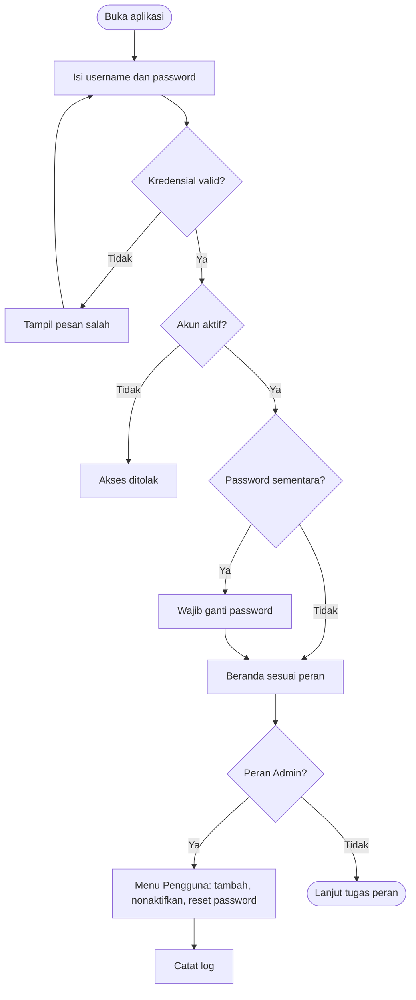

## UF-02 Kelola Anggota dan Impor CSV

| Atribut | Isi |
| --- | --- |
| Flow Name | Kelola anggota dan impor CSV |
| Actor | Admin |
| Trigger | Admin ingin mengisi atau memperbarui data anggota tenant |
| Preconditions | Admin login, tenant sudah dipilih |
| Main Flow | 1) Buka menu Anggota. 2) Pilih Impor CSV, unduh template jika perlu. 3) Unggah file. 4) Sistem memvalidasi tiap baris. 5) Tampil pratinjau: baris valid dan baris gagal. 6) Admin konfirmasi impor. 7) Data masuk, total NPP pemilik dihitung. |
| Alternative Flow | Input manual satu per satu. Ubah data anggota: nilai lama disimpan sebagai riwayat. |
| Exception Flow | Format bukan CSV: ditolak. Baris gagal tidak ikut diimpor dan ditampilkan beserta alasan. |
| Validation Rules | Kolom wajib: no\_unit, nama\_anggota, nama\_tenant, npp. NPP angka lebih dari 0. no\_unit unik per tenant. Satu unit hanya satu pemilik. Pemilik dengan banyak unit digabung berdasarkan nama pemilik. |
| Error Scenario | "Baris 12: NPP bukan angka". "Unit A-101 duplikat". |
| Post Conditions | Data anggota tersimpan, log impor tercatat, riwayat perubahan tersimpan |

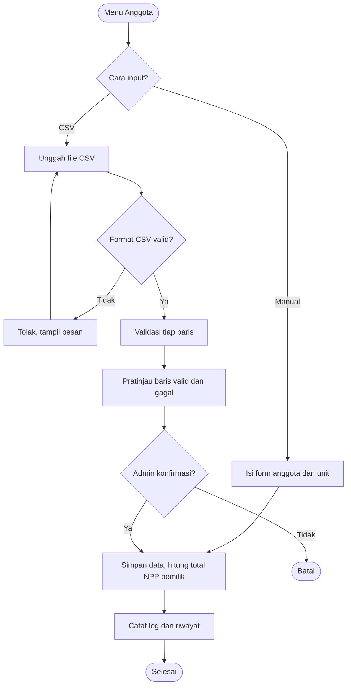

## UF-03 Buat Sidang, Agenda, dan Soal

| Atribut | Isi |
| --- | --- |
| Flow Name | Buat sidang, agenda, dan soal voting |
| Actor | Admin |
| Trigger | Persiapan MUTA atau RUTA |
| Preconditions | Data anggota tenant sudah ada |
| Main Flow | 1) Buat sidang: jenis, judul, tanggal, lokasi, ambang kuorum (default 50%). 2) Tambah agenda berurutan. 3) Pada tiap agenda, buat soal: jenis, pilihan, maksimal pilihan (pilih banyak), durasi hitung mundur. 4) Simpan. Status sidang menjadi draft. |
| Alternative Flow | Unggah materi sidang (PDF/JPG/JPEG/PNG). Ubah urutan agenda. |
| Exception Flow | Soal tanpa pilihan: tidak dapat disimpan. File materi format salah: ditolak. |
| Validation Rules | Pilihan minimal 2. Maks pilihan antara 1 dan jumlah pilihan. Durasi minimal 10 detik. Soal setuju/tidak/abstain otomatis memiliki 3 pilihan. |
| Error Scenario | "Maksimal pilihan melebihi jumlah pilihan". |
| Post Conditions | Sidang, agenda, dan soal tersimpan dan siap dipakai |

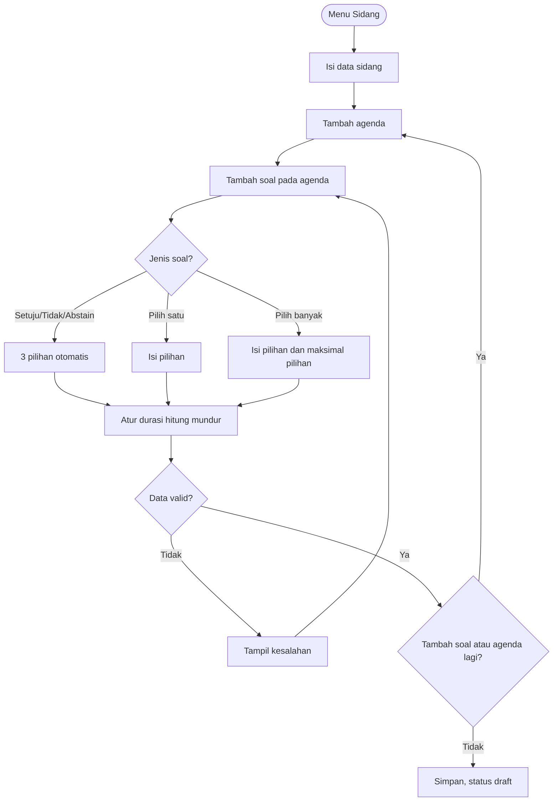

## UF-04 Buat Undangan, QR, dan Draft Email/WA

| Atribut | Isi |
| --- | --- |
| Flow Name | Buat undangan, QR Code, dan draft email/WhatsApp |
| Actor | Admin |
| Trigger | Admin siap mengirim undangan |
| Preconditions | Sidang dan data anggota tersedia |
| Main Flow | 1) Buka sidang, pilih Buat Undangan. 2) Sistem membuat UID acak per pemilik. 3) Pilih pemilik, lihat draft email: nama tenant dan nama personal, jenis dan tanggal sidang, lokasi, agenda, QR di badan email, tata tertib, tanda tangan pengurus. 4) Klik Salin ke clipboard. 5) Tempel ke Outlook dan kirim manual. |
| Alternative Flow | Pilih draft lain: pengingat H-1, kirim ulang QR, ucapan terima kasih, hasil sidang, teks WhatsApp. QR hilang: Admin menerbitkan QR baru, QR lama tidak berlaku. |
| Exception Flow | Salin gagal di browser: tampil tombol unduh gambar QR dan salin teks terpisah. Pemilik tanpa email: tandai, kirim via WhatsApp. |
| Validation Rules | Satu UID per pemilik per sidang. QR berisi UID saja. QR satu kali pakai. |
| Error Scenario | "Gambar QR gagal dibuat, muat ulang halaman". |
| Post Conditions | Undangan berstatus QR aktif, penerbitan QR tercatat di log |

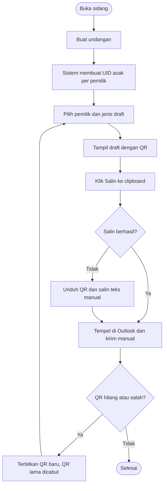

## UF-05 Kelola Kuasa

| Atribut | Isi |
| --- | --- |
| Flow Name | Kelola kuasa |
| Actor | Admin |
| Trigger | Pemilik mewakilkan kehadirannya |
| Preconditions | Sidang aktif, pemberi kuasa terdaftar dan belum hadir |
| Main Flow | 1) Pilih pemberi kuasa. 2) Isi nama penerima kuasa. 3) Unggah surat kuasa. 4) Sistem menyimpan ke Drive dan membuat QR kuasa. 5) Penerima kuasa membawa QR dan hak suara pemberi kuasa. |
| Alternative Flow | Pemberi kuasa ingin hadir sendiri: Admin membatalkan kuasa dengan alasan, QR kuasa nonaktif, pemilik check-in sendiri. |
| Exception Flow | Pemberi kuasa sudah memiliki kuasa: ditolak. Pemberi kuasa sudah check-in: ditolak. |
| Validation Rules | Satu undangan satu kuasa. File PDF/JPG/JPEG/PNG. Surat wajib diunggah, tanpa verifikasi. |
| Error Scenario | "Format file tidak didukung". "Pemilik ini sudah memiliki kuasa". |
| Post Conditions | Kuasa tersimpan, log tercatat. Kartu dashboard menampilkan penerima dan pemberi kuasa |

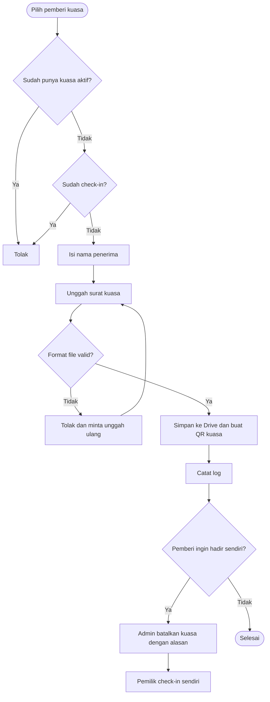

## UF-06 Check-in Scan QR

| Atribut | Isi |
| --- | --- |
| Flow Name | Check-in scan QR |
| Actor | Petugas Registrasi |
| Trigger | Peserta menunjukkan QR undangan |
| Preconditions | Petugas login, kamera diizinkan, sidang aktif |
| Main Flow | 1) Buka layar Scan. 2) Arahkan kamera ke QR. 3) Sistem memvalidasi UID. 4) Tampil "Check-in berhasil" dengan nama, unit, NPP, dan label On time/Late. 5) Kuorum dihitung ulang. |
| Alternative Flow | Kamera gagal: gunakan check-in manual (UF-07). Peserta kuasa: tampil nama penerima dan pemberi kuasa. |
| Exception Flow | QR sudah dipakai: ditolak, peringatan merah, notifikasi ke Admin dan Panitia, log. QR tidak dikenal atau dicabut: ditolak. Kamera tidak diizinkan: panduan membuka izin. |
| Validation Rules | UID ada dan milik sidang aktif. Status QR aktif. Label Late jika setelah waktu Mulai Sidang. |
| Error Scenario | "QR sudah dipakai pada 09:12". "QR tidak valid". |
| Post Conditions | Status HADIR, waktu dan label tersimpan, NPP hadir bertambah, dashboard terbarui |

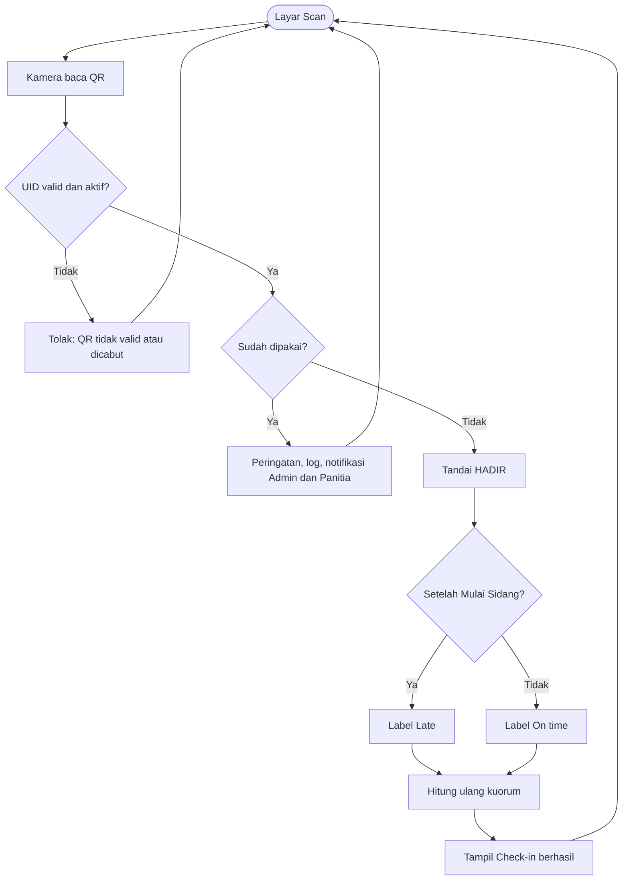

## UF-07 Check-in Manual dan Pembatalan Check-in

| Atribut | Isi |
| --- | --- |
| Flow Name | Check-in manual dan pembatalan check-in |
| Actor | Petugas Registrasi (check-in manual), Admin (pembatalan) |
| Trigger | QR tidak terbaca, kamera gagal, atau salah scan |
| Preconditions | Login, sidang aktif |
| Main Flow | 1) Petugas mencari nama atau unit. 2) Pilih peserta. 3) Isi alasan wajib. 4) Konfirmasi. 5) Status HADIR dengan metode manual. Pembatalan: Admin memilih peserta, mengisi alasan, status kembali BELUM HADIR, QR kembali aktif. |
| Alternative Flow | Daftar hadir kertas dipakai saat sistem bermasalah, data diinput setelah normal. |
| Exception Flow | Peserta sudah HADIR: ditolak. Alasan kosong: tidak dapat disimpan. |
| Validation Rules | Alasan wajib. Petugas hanya melihat nama, unit, dan NPP (tanpa data pribadi). |
| Error Scenario | "Alasan wajib diisi". "Peserta sudah hadir". |
| Post Conditions | Status dan kuorum diperbarui, log tercatat dengan alasan |

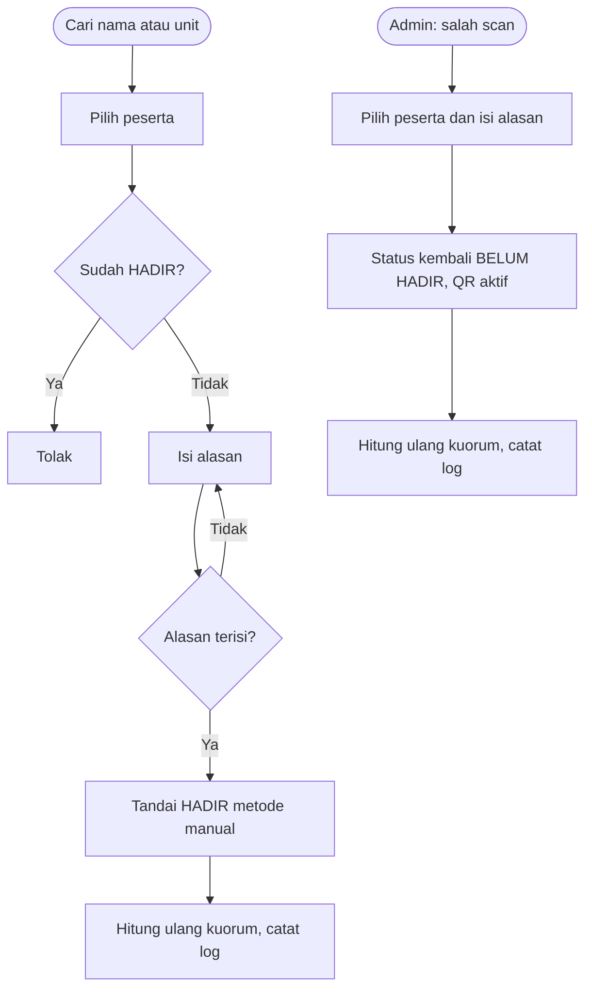

## UF-08 Mulai Sidang, Pantau Dashboard, Catat TIDAK HADIR

| Atribut | Isi |
| --- | --- |
| Flow Name | Mulai Sidang, pantau dashboard, dan catat TIDAK HADIR |
| Actor | Panitia (Admin juga dapat melakukan) |
| Trigger | Waktu sidang tiba |
| Preconditions | Sidang berstatus draft atau aktif, check-in sudah berjalan |
| Main Flow | 1) Panitia membuka Dashboard Kehadiran di tab proyektor. 2) Menekan Mulai Sidang, waktu tercatat sebagai patokan Late. 3) Memantau card peserta, persen NPP hadir, dan kuorum. 4) Saat NPP hadir lebih dari 50%, animasi kuorum tampil. 5) Jika ada anggota memberi kabar tidak hadir, Panitia mencatat status TIDAK HADIR. |
| Alternative Flow | Cari atau filter card berdasarkan status, nama, atau unit. Panitia memakai tampilan kontrol di tab terpisah dari layar proyektor. |
| Exception Flow | Koneksi putus: dashboard menampilkan indikator offline dan mencoba ulang otomatis. Sidang sudah dimulai: tombol Mulai nonaktif. |
| Validation Rules | Mulai Sidang hanya sekali. TIDAK HADIR hanya untuk peserta yang belum HADIR. Refresh 5 detik. |
| Error Scenario | "Tidak dapat memuat data, mencoba lagi". |
| Post Conditions | Status sidang berjalan, waktu mulai tersimpan, log tercatat |

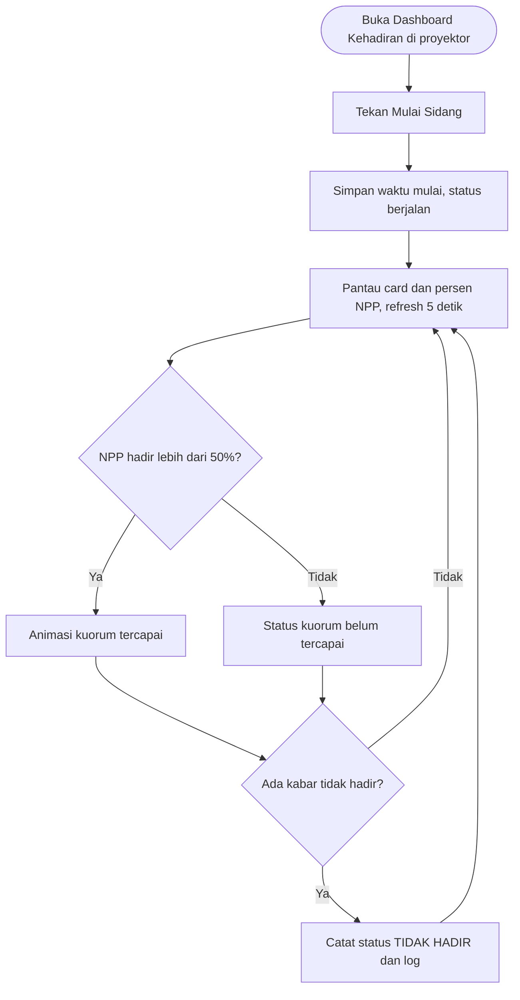

## UF-09 Buka dan Tutup Soal Voting

| Atribut | Isi |
| --- | --- |
| Flow Name | Buka dan tutup soal voting |
| Actor | Panitia |
| Trigger | Agenda masuk tahap pemungutan suara |
| Preconditions | Sidang berjalan, kuorum tercapai, soal sudah dibuat Admin |
| Main Flow | 1) Pilih soal dari agenda. 2) Tekan Buka Soal. 3) Sistem mengecek kuorum dan soal lain yang terbuka. 4) Soal terbuka, hitung mundur dimulai, HP pemilih menerima "Voting dimulai". 5) Dashboard Voting menampilkan jumlah sudah memilih/hadir. 6) Soal ditutup oleh Panitia atau hitung mundur habis. 7) Hasil agregat berbobot NPP tampil di proyektor. |
| Alternative Flow | Panitia menutup lebih awal. Peserta terlambat yang check-in saat soal berjalan boleh ikut memilih. |
| Exception Flow | Kuorum belum tercapai: soal diblokir dengan pesan alasan. Ada soal lain terbuka: ditolak. |
| Validation Rules | Hanya satu soal terbuka pada satu waktu. Hasil baru tampil setelah soal ditutup. |
| Error Scenario | "Kuorum belum tercapai, soal tidak dapat dibuka". |
| Post Conditions | Soal berstatus ditutup, baris suara diacak, hasil agregat tersimpan, log tercatat |

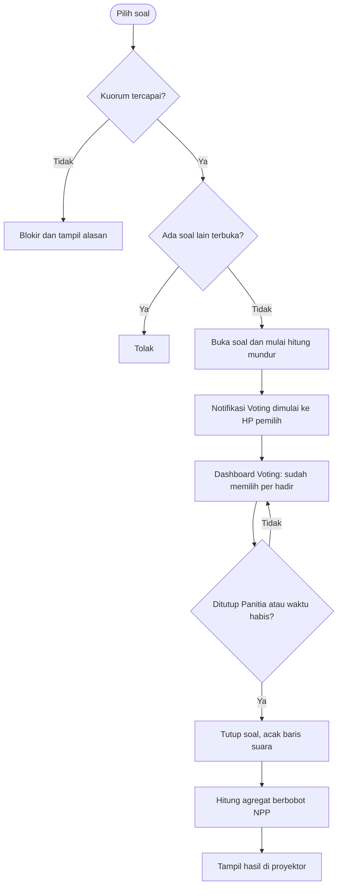

## UF-10 Memberikan Suara

| Atribut | Isi |
| --- | --- |
| Flow Name | Memberikan suara (gaya Kahoot, rahasia) |
| Actor | Pemilih (tanpa login) |
| Trigger | Pemilih membuka tautan atau QR voting umum yang dibagikan Panitia |
| Preconditions | Pemilih sudah check-in (HADIR), tidak di-kick, soal terbuka |
| Main Flow | 1) Buka tautan voting di HP. 2) Pilih nama dari daftar peserta yang sudah check-in. 3) Lihat soal dan hitung mundur. 4) Pilih jawaban (setuju/tidak/abstain, pilih satu, atau pilih banyak hingga batas maksimal). 5) Tekan Kirim. 6) Sistem menyimpan suara dengan bobot NPP, menandai "sudah memilih" di tabel terpisah. 7) Tampil "Suara Anda tercatat". |
| Alternative Flow | Soal belum dibuka: layar menunggu. Pemilih terlambat check-in: tetap dapat memilih soal berjalan. Kuasa: memilih dengan bobot pemberi kuasa. |
| Exception Flow | Nama tidak ada atau belum check-in: ditolak. Sudah memilih: ditolak. Di-kick: "Anda dikeluarkan panitia". Waktu habis: pilihan ditutup. Koneksi putus: kirim ulang, suara ganda ditolak. |
| Validation Rules | Satu suara per pemilik per soal. Jumlah pilihan tidak melebihi maksimal. Soal harus terbuka. Pemilih tidak dapat mengubah suara. |
| Error Scenario | "Nama Anda belum check-in". "Anda sudah memilih". "Waktu habis". |
| Post Conditions | Satu suara tercatat tanpa nama, rahasia terjaga, jumlah sudah memilih bertambah |

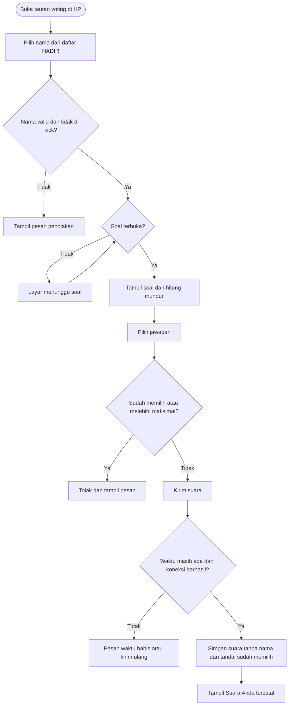

## UF-11 Kick dan Aktifkan Kembali Peserta

| Atribut | Isi |
| --- | --- |
| Flow Name | Kick dan aktifkan kembali peserta |
| Actor | Panitia |
| Trigger | Nama yang dipakai di HP tidak sesuai dengan peserta |
| Preconditions | Sidang berjalan, peserta tercatat HADIR |
| Main Flow | 1) Panitia membuka daftar peserta voting. 2) Memilih peserta, tekan Kick. 3) Sistem memblokir suara berikutnya, suara yang sudah masuk tetap dihitung. 4) HP peserta menampilkan "Anda dikeluarkan panitia". 5) Log tercatat. |
| Alternative Flow | Peserta sah yang keliru di-kick: Panitia menekan Aktifkan Kembali, log tercatat. |
| Exception Flow | Peserta belum HADIR: tidak dapat di-kick. |
| Validation Rules | Hanya Panitia. Aksi wajib tercatat di log. |
| Error Scenario | "Aksi gagal, coba lagi". |
| Post Conditions | Status dikick tersimpan, peserta diblokir atau diaktifkan kembali |

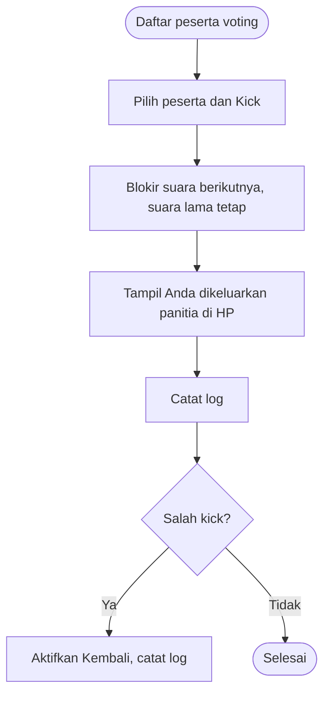

## UF-12 Tutup Sidang, Laporan, dan Berita Acara

| Atribut | Isi |
| --- | --- |
| Flow Name | Tutup Sidang, laporan, dan berita acara |
| Actor | Panitia (tutup sidang), Admin (laporan untuk notaris) |
| Trigger | Seluruh agenda selesai |
| Preconditions | Tidak ada soal terbuka |
| Main Flow | 1) Panitia menekan Tutup Sidang. 2) Sistem mengunci rekap. 3) Admin atau Panitia membuka menu Laporan. 4) Pilih laporan (daftar hadir, rekap kuorum, hasil voting, kuasa, log, riwayat). 5) Ekspor PDF atau Excel. 6) Admin membuat berita acara otomatis, melengkapi, dan menandatangani manual. 7) Admin mengirim PDF ke notaris. |
| Alternative Flow | Draft email hasil sidang dan ucapan terima kasih. Salinan manual Spreadsheet setelah sidang. |
| Exception Flow | Masih ada soal terbuka: Tutup Sidang ditolak. Ekspor gagal: coba lagi. |
| Validation Rules | Panitia hanya melihat data tanpa data pribadi. Rekap terkunci setelah tutup. |
| Error Scenario | "Tutup soal yang masih terbuka terlebih dahulu". |
| Post Conditions | Sidang ditutup dan terkunci, laporan tersedia, log tercatat |

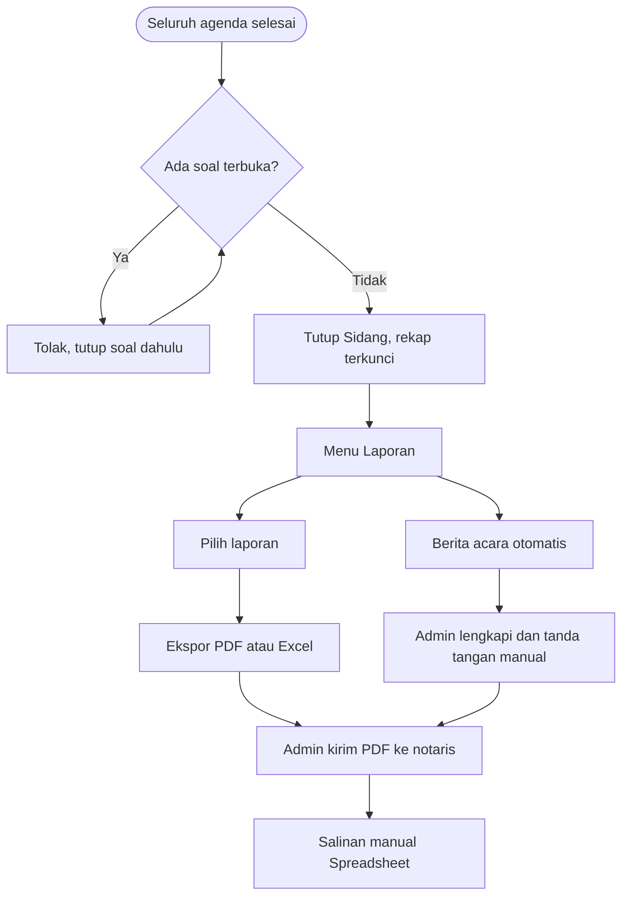

## UF-13 Ubah Rekap Terkunci

| Atribut | Isi |
| --- | --- |
| Flow Name | Ubah rekap terkunci |
| Actor | Admin |
| Trigger | Ditemukan kesalahan setelah sidang ditutup |
| Preconditions | Sidang berstatus terkunci |
| Main Flow | 1) Admin membuka sidang terkunci. 2) Memilih data yang diubah. 3) Mengisi alasan wajib. 4) Konfirmasi. 5) Data berubah, nilai lama dan baru masuk log. |
| Alternative Flow | Batal tanpa mengubah. |
| Exception Flow | Alasan kosong: tidak dapat disimpan. Peran bukan Admin: ditolak. |
| Validation Rules | Hanya Admin. Alasan wajib. Perubahan tercatat penuh. |
| Error Scenario | "Alasan wajib diisi". |
| Post Conditions | Rekap diperbarui, log perubahan lengkap |

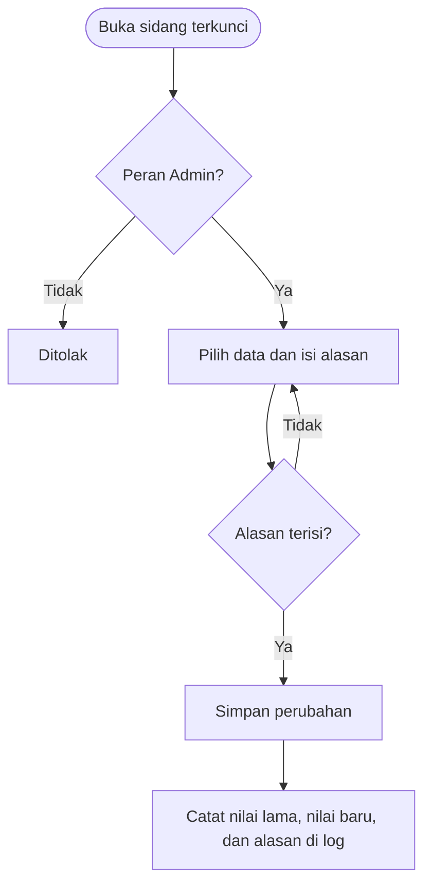

## UF-14 Lihat Riwayat Antar Sidang

| Atribut | Isi |
| --- | --- |
| Flow Name | Lihat riwayat antar sidang |
| Actor | Admin, Panitia |
| Trigger | Ingin membandingkan kehadiran dan hasil voting antar sidang |
| Preconditions | Tenant memiliki satu sidang atau lebih |
| Main Flow | 1) Buka menu Riwayat. 2) Pilih tenant. 3) Lihat daftar sidang (MUTA/RUTA, tahun). 4) Pilih sidang untuk detail kehadiran dan hasil voting. 5) Ekspor PDF atau Excel. |
| Alternative Flow | Pilih beberapa sidang untuk dibandingkan. |
| Exception Flow | Belum ada sidang: tampil keadaan kosong. |
| Validation Rules | Pengguna hanya melihat tenant yang ditugaskan. Hasil voting hanya agregat. |
| Error Scenario | "Belum ada riwayat sidang". |
| Post Conditions | Tidak ada perubahan data, ekspor tercatat di log |

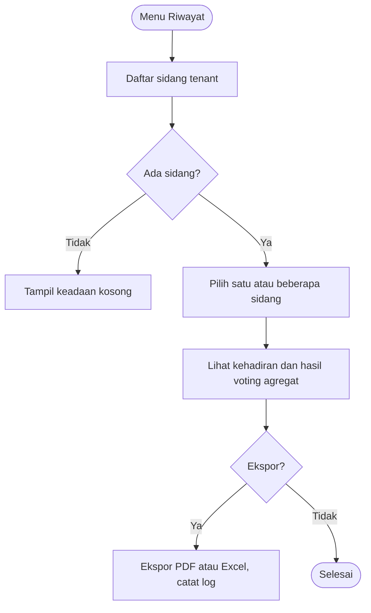
